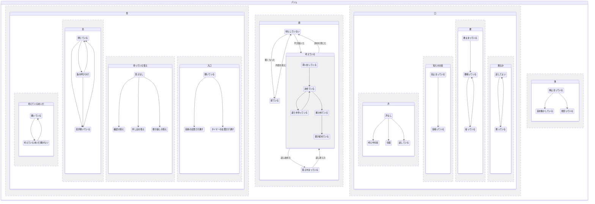
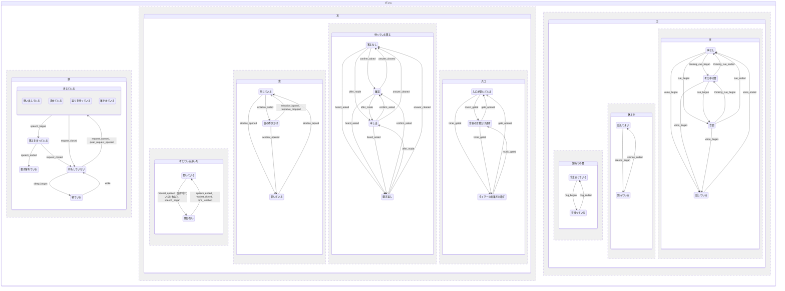

# familiar-ai 設計方針：パジュの状態（v0.24）

> **パジュの状態**（耳、頭、口、体がいま何をしているか）を、1 つの状態図で持つための設計方針（環-aw、2026-11-04〜12、本人の決定ア〜ン）。
> **頭（寝ているを含む）、耳の 4 つの領域（考えているあいだ、窓、待っている答え、入口）、口の黙るか、声、知らせの音は実装した**（環-aw 第 1 段、2026-11-08〜10、`f920f53d`〜`175d7a1c`。第 2 段、2026-11-12、`c6b3a279`〜`10c3195c`。第 3 段、2026-11-17、`f110eca8`。第 4 段、2026-11-17、`ea41a345`。第 5 段、2026-11-20。第 6 段 項目 1（知らせの音）、2026-11-21。状態図は `loop/paju_state.py` の `PajuState`）。体と、口の歌はこれから作る。表の「いまの持ち主」は、v0.5 で直した行（窓、仮の呼びかけ、黙っている）が 2026-11-12 のコード（v0.10c31）、v0.15 で直した行（待っている答え、入口）が 2026-11-17 のコード、ほかの行が 2026-11-11 のコード（v0.3b5a7）の事実である。
> 本人の指示は「パジュにたった一つの状態を持たせてください。そして、さまざまなイベントに対して、状態の変化を管理するようにしてください」「この仕組みは claude.md に記載する根源的な仕組みにしなさい」。

## 1. 1 つの状態図にする理由

パジュの状態は、状態図を作る前は別々の器に散らばっていた。黙る依頼は `agent_state` の `silence_request`、名前で開く窓は `WakeWindow`、仮の呼びかけは `_tentative_call`、考えているあいだ聞かないことは電子音の仕事が生きているか（v0.3 までの `_deaf_while_beeping`、第 1 段で撤去）、調べもの中は `Lookup.in_flight`、確認待ちは agent の `_pending_confirm`（第 3 段で撤去）が持っていた。縛り合う 2 つの状態は、片方の持ち主がもう片方を覗いて合わせている。頭、耳、黙る依頼を状態図へ移したいまも、ほかの器（調べもの中など）は残っている。

このため、どちらかが先に変わると、そのあいだだけ 2 つが食い違う。§5 の 6 件は、どれもこの食い違いが実機で表に出たものである。たとえば 10/18 には、確認を聞き返しているあいだに窓が閉じ、名前の無い「はい」が捨てられた。

そこで、パジュの状態を 1 つの**状態図**（Statecharts）にまとめ、状態を変えるのは**事象**だけにする。事象とは、パジュの状態を移すもの（声が届いた、話し終えた、タイマーが鳴った、など）である。状態図の書き方は Harel（1987）が考え、W3C SCXML が決まりにした[^statecharts]。

[^statecharts]: D. Harel, "Statecharts: A Visual Formalism for Complex Systems", Science of Computer Programming 8 (1987)。W3C, "State Chart XML (SCXML): State Machine Notation for Control Abstraction" (2015)。仕組みの先例は `モジュール分割設計` v0.43 の行 271 にある。

## 2. 状態図の形

状態図は、同時に動く 4 つの**並行の領域**（耳、頭、口、体）を持つ。**領域**は、同時にどれか 1 つの状態だけを取る区切りである（決定ア、イ、ウ）。耳と口の中は、さらに**入れ子の領域**に分ける。耳は考えているあいだ、窓、待っている答え、入口の 4 つ、口は声、知らせの音、歌、黙るかの 4 つである（決定オ、ネ。v0.5 で聞き方を考えているあいだと窓に分け、黙っているを口の黙るかへ移した）。

状態図は `python-statemachine` の `StateChart` で書く（決定ス）。この検討のあいだに、版 3.2.2 で並行の領域と入れ子を一度きりの試しで書き、動くことを確かめた。入るときの動作の中で待っているあいだも、外から今の状態を読めた。遅れて起こす事象（`send` の `delay`）は、裏の仕事として送れば `cancel_event` で取り消せた（`await` で直に送ると、遅れのぶん送った側が止まる）。第 1 段で、承認を得て依存に足した（`pyproject.toml` の `python-statemachine==3.2.2`）。

図の状態名のうち「答えなし」「声なし」「音止まっている」「音鳴っている」「歌止まっている」「歌鳴っている」「体止まっている」は、図の上で名前が重ならないように付けたもので、表の「なし」「止まっている」「鳴っている」と同じ状態である。図には戻りの移りを一部しか書いていない。移りの全部は §3 の表に書く。

領域どうしの同期は、Statecharts の決まりにそろえる（決定エ）。

- **一斉配信**：1 つの事象を、すべての領域へ同時に届ける。
- **移りの中で事象を起こす**：移りの途中で新しい事象を起こし、ほかの領域を動かす。
- **一歩を最後まで**：1 つの事象による移りを全部やり終えてから、次の事象を受ける。途中の食い違った状態は、外から見えない。
- **入るときの動作、出るときの動作**：ある状態に入るとき、出るときに、必ず行う動作。
- **禁止の条件**：ほかの領域の状態を見て、移りを止める条件。ほかの領域を条件に見るのは、禁止のときだけにする。

状態図が移りを持たずに捨てた事象は、事象の名前と、そのときの各領域の状態を 1 行ログに残す（決定ユ）。ふだんは情報の段（`info`）で書き、1 秒ごとの見張りのように頻繁な事象は開発者向けの段（`debug`）にする。言葉の中身は書かない。

長い仕事は、入るときの動作の中で待つ（決定セ。ただし第 1 段の実装では、入るときの動作から立てる仕事を外の仕事にし、中では待たない。§2.1）。待っているあいだは状態図全体が止まり、そのあいだに届いた事象は、仕事を終えてから順に処理される（同じ一度きりの試しで確かめた）。

周りの事実は、状態図の状態にしない。移りを決める条件として読む（決定ア）。周りの事実は、タイマーが動いているか、在席と顔ぶれといまの話者（話者は 60 秒で切れる）、静穏時間、夜、カメラが使えるか、である。気分（P、A、Dom）と欲求（SEEKING、REST、BOND など）は数値なので、これも状態にしない。

### 2.1 実装した頭、耳、口

第 1 段から第 6 段で実装した状態図（`PajuState`）は、頭、耳、口の 3 つの並行の領域を持つ。耳は考えているあいだ、窓、待っている答え、入口の 4 つの並行の領域を持ち、口はいまは黙るか、声、知らせの音の 3 つの領域を持つ。

下の図は手で書かず、コードから作る（v0.24・環-bb 一段目・2026-11-21。本人の決定「図はコードから自動で作る」）。状態図の型（`PajuState`）を `loop/paju_state_chart.py` が読み出して Mermaid にし、試験（`tests/test_paju_state_chart.py`）が、この図と作った図の一致を確かめる。描かないのは、初めの状態へ入る移り、内側の移り（考えているの子へ移るもの）、自分へ戻る移り。図を直すときは `uv run python -m familiar_agent.loop.paju_state_chart` の出力を貼る。手で書いていた v0.23 までの図は、待っている答えのあいだの上書きの移り 6 本（確認・申し出・聞き返しのあいだの `confirm_asked`・`offer_made`・`heard_asked`、決定ノ）を描き漏らしていた。

**知らせの音**（第 6 段 項目 1、2026-11-21）は、タイマーとアラームの音の領域である。持ち主は dif の鳴らしている仕事（`_ring_task`）で、状態図はその**写し**である（入口と同じ形）。写す口は `copy_ring` で、順番が来てから持ち主を読み、違うときだけ `ring_began` か `ring_ended` を送る。写すのは自律機構の輪（0.5 秒ごと）だけで、写したら「状態図 知らせの音を写した：…」を 1 行残す。dif から写す仕事を立てる形は、仕事の参照が消える、閉じるときに仕事を立てる、打ち切りで写しが漏れる、の穴があったのでやめた（2 回目の見直し）。いま鳴っているか（dif の `ringing`。タイマーの欄、ループの `_ringing`、止める口）は、いままでどおり持ち主を読む。状態図を持ち主にしなかったのは、鳴らす口と止める口が同期の関数で、事象の処理を待てないからである。持ち主にした試しでは、鳴っているあいだに次の音を鳴らすと、古い仕事の終わりの事象が後から届いて、音が鳴っているのに止まっているになった。止めた直後もしばらく鳴っているに見え、状態図の順番がふさがっていると音そのものが遅れた（2026-11-21 の見直し）。写しは、ふだんは鳴らし始めと止めたあとの 0.5 秒までは前の状態のままである。自律機構の輪は内省のあいだ止まるので、そのあいだはもっと遅れる。写しを読むのは状態の行だけで、歌（第 6 段 項目 2）は写しでなく持ち主を読む。状態の行には「知らせの音=止まっている／鳴っている」と出す。

頭と、耳の考えているあいだを動かす事象は次のとおりである（第 1 段）。表の「耳」は、考えているあいだの領域を指す。

| 事象 | 送る所 | 頭 | 耳 |
|---|---|---|---|
| `request_opened` | 求めを開いたとき | 何もしていない → 考えている（子は思い出している） | 聞いている → 聞かない |
| `quiet_request_opened` | 話しかけない発火（seeking、safety）の求めを開いたとき（`_begin_request`） | 何もしていない → 考えている（子は思い出している） | 移らない（聞いたまま。決定ザ） |
| `recall_began`、`decide_began`、`wait_began`、`check_began`、`note_began` | メインのループの段に入るとき | 考えているの中で、その子へ移る | 移らない |
| `speech_began` | 答えの声を出し始めるとき | 考えている → 答えを言っている | 聞いている → 聞かない |
| `speech_ended` | 答えの声を言い終えたとき（再生に失敗したときも） | 答えを言っている → 書き留めている | 聞かない → 聞いている |
| `request_closed` | 求めを閉じたとき。例外や中断で閉じる所に届かなかったときも送る（`_hear_again`） | 何もしていないへ | 聞かない → 聞いている |
| `limit_reached` | 考えているが上限に届いたとき、電子音を鳴らせなかったとき | 移らない | 聞かない → 聞いている |

頭が答えのあとに考えているへ戻っても、耳は聞いたままにする（決定モ）。耳を頭に入るときの動作で動かさず、事象で動かすのはこのためである（考えているに入るときの動作で耳を閉じると、書き留めているあいだに届いた声を捨ててしまう）。

入るときの動作は 2 つある。考えているの子に入ると、電子音の仕事を立てる（立っていれば何もしない、§3.3）。何もしていないに入ると、電子音の仕事を片付け、鳴らした回数を 0 に戻す（`_on_head_idle`）。電子音を片付けるのは、求めの閉じ方によらず、状態の移りである。考えているの合計を数える仕事も、入るときの動作から立てる（§3.4）。

入るときの動作から立てる仕事（電子音、数える仕事）は、状態図の処理の文脈を受け継がない形で立てる（`core/aio.spawn_outside`）。受け継ぐと、その仕事が送った事象に待つ口が付かず、列に残る。このため長い仕事は、決定セの「入るときの動作の中で待つ」形ではなく、外の仕事として立てている。答えの声も、入るときの動作の中では待たず、声を出す口（`_say_aloud`）が `speech_began` と `speech_ended` を送る。

送る口は `fire` の 1 つである（ループからは `_to_state`）。状態図が落ちても、会話は止めず、警告を 1 行残す。移りの無い事象は捨て、事象の名前と各領域の状態を 1 行残す（決定ユ）。耳がもう聞いているときは、数える仕事も電子音の仕事も `limit_reached` を送らない。移りの無い事象を送ると、ライブラリがそのとき列に待っていたほかの事象も退けて、列を空にするからである。

送る口は、1 つの順番待ちに並ぶ（決定ン、2026-11-12）。ライブラリは、事象を処理している途中で動作を `asyncio.gather` で呼び、ほかの仕事に順番を譲る。そのあいだに送られた事象は列に並び、まだ処理されていないので、ほかの口から見える状態は古い。古い状態を見て送った事象は移りが無く、ライブラリはそのとき列に並んでいたほかの事象も退ける。試しでは、窓が開くのと仮の呼びかけが切れるのが頭の事象の処理中に重なると、後ろの頭の事象まで捨てられた。「黙って」と「話していいよ」が重なると、状態が黙っているに残り、控えが消したあとに書かれた。そこで、外から送る口 `fire` は順番（`_turn`）を待ってから送る。状態を見て送る口（窓を開ける、延ばす、仮の呼びかけを置く、捨てる、時間で切れる移りを数える仕事、考えているの上限）は、順番の中で、見る、データを変える、送るを続けて行う。黙らせる口 `hush_with` と解く口 `unhush` は、依頼と控えを待たずにその場で置く（消す）。そのあとで順番を待ち、順番が来たら依頼を読み直して、口の状態を依頼に合わせる（`_settle_silence`）。呼び手は、いまの依頼を読んで次の依頼を決めてから呼ぶ。置く前に待たせると、待つあいだに読んだ値が古くなり、タイマーの依頼が人の依頼を上書きしうるからである。順番の中から送る口は `_fire` で、順番を待たない。こうすると、ライブラリの列にはいつも事象が 1 つしか並ばない。錠は作ったループに縛られるので、走っているループが変わったら作り直す。状態図に入るときの動作の中からは `fire` を待たない（順番を持った送り手が、その動作の終わりを待っているので止まる）。動作の中で送るときは、外の仕事として立てる。

窓と黙るかを動かす事象は次のとおりである（第 2 段）。同じ状態へ戻る移りは、外へ出て入り直す形にした[^itself]。

| 事象 | 送る所 | 移り |
|---|---|---|
| `window_opened` | 窓を開けたとき（名前、キーボード、確認の問いか名前つきの求めの返事か話しかける発火（bond、esteem）の一言を言い終えた、名前つきの解く言葉）と、延ばしたとき、話し終えたときに、データの上で窓が開いていれば | 閉じている、仮の呼びかけ → 開いている（開いているからは入り直す） |
| `window_lapsed` | 窓の時間を数える仕事が、切れたとき | 開いている → 閉じている |
| `tentative_called` | 名前だけで確かさの足りない声が届いたとき（状態が開いていなければ） | 閉じている → 仮の呼びかけ（仮の呼びかけからは入り直す） |
| `tentative_lapsed` | 仮の呼びかけの 10 秒を数える仕事が、切れたとき | 仮の呼びかけ → 閉じている |
| `tentative_dropped` | 鳴っているあいだの音楽の言葉を、窓を開けずに受けたとき | 仮の呼びかけ → 閉じている |
| `silence_began` | 黙る依頼を受けたとき（「黙って」、タイマー）と、再起動で控えを戻したとき | 話してよい → 黙っている（黙っているからは入り直す） |
| `silence_ended` | 名前つきの「話していいよ」、止めたタイマー、期限 | 黙っている → 話してよい |

[^itself]: `python-statemachine` 3.2.2 の `internal=True` の形では、並行の領域の中で、ほかの領域の状態が二重になった（2026-11-12 の一度きりの試し）。このため `x.to.itself()` の形にした。

窓、仮の呼びかけ、黙るかは、状態とデータの両方を持つ。データは、窓が `WakeWindow`（`PajuState.wake`）、仮の呼びかけが届いた時刻（`tentative_at`）、黙るかが依頼（`SilenceRequest`、`silence`）である。門は状態ではなくデータで決める。窓の中だったかと、仮の呼びかけの続きかは、届いた時刻（声なら話し始め）で決め、黙っているかは処理した時刻で決める。このため、切れる直前に話し始めた声は、状態が閉じているへ移ったあとでも、同じ窓の会話として受ける。状態は、移りとログ（`describe` の「頭=… 耳=…/窓=…/答え=…/入口=… 口=…」）のために持つ。

データを変えるのは状態図の口だけで、口が事象を送る。

- **窓**：`open_window`（開ける）、`extend_window`（延ばす）。読む口は `window_open_at`。話しているあいだ窓を保つのは、声の話しているに入るときと出るときの動作である（第 5 段、下の声の段落）。
- **仮の呼びかけ**：`call_tentatively`（預ける）、`drop_tentative`（捨てる）。読む口は `tentative_since`。
- **黙るか**：`hush_with`（黙る）、`unhush`（解く）。読む口は `silence_request` と `is_silent`。

窓のデータを `window`、黙る口を `hush` と名付けなかったのは、領域の名前と重なり、ライブラリが許さないからである。

時間で切れる 3 つの移り（窓、仮の呼びかけ、黙るの期限）は、状態図の中の数える仕事が送る（決定ヰ）。送る前に状態を見る。移りの無い事象を送ると、ライブラリがそのとき列に待っていたほかの事象も退けるからである。送っているあいだは仕事を止めず（送っているあいだの印）、送り終えたらデータを見て、まだ生きていれば元の状態へ戻す。窓が切れたとき、窓が開いているあいだに届いた仮の呼びかけがまだ生きていれば、仮の呼びかけへ移す。期限で解けたことを送れずに、データが無いのに黙っているに残ったときは、次の `unhush` で話してよいへ戻す。黙るの期限を数える仕事は、口の状態ではなく依頼に従う。依頼があれば数え、期限が来たら依頼と控えをいつも消し、黙っているにいるときだけ `silence_ended` を送る。黙っているへ移るのが落ちても、期限で依頼と控えが消える（落ちたまま数えなければ、控えの行が次の再起動まで残った）。ループを閉じるときは、数える仕事をみな止める（`end_timers`）。

黙っている依頼の持ち主は状態図で、DB の `agent_state` の `silence_request` の行は、再起動で消えないための控えである（決定ヱ）。依頼を置くと控えを書き（`save_silence`）、解くと消す（`clear_silence`。タイマー由来の依頼も、期限で消す）。`start` で初めの状態に入ったあと、控えを 1 度だけ戻す。生きていれば残りの期限で黙り、過ぎていれば控えを消す。

`start` を待ってから読む読み手は、門、dif の声の口（求めの外の声を鳴らす前に黙るかを見る、第 5 段）、黙る口と解く口（`hush_with`、`unhush`）、タイマーの沈黙を掛ける口と解く口（`agent._hush_for_timer`、`_unhush_timer`）、「話していいよ」の口（`_release_silence`）である。同時に待つ読み手も、戻し終えるまで待つ。戻しが途中で落ちたら、待っていた読み手が戻し直す。ほかの事象でひとりでに初めの状態に入っていても、初めての `start` で戻す。タイマーを掛ける前の確かめ（`agent._silence_active_now`）と調停へ渡す一行（`_silence_note`）は、`start` を待たずに読む。どちらも求めの中で読まれ、求めは開くときに `start` を待つ（`_begin_request` が `request_opened` を送るとき）ので、戻し終えたあとに読まれる。

状態図は、ループを作った時点で作り、`agent.paju_state` に置く。文字コマンド（`/timer stop`）は門より前に agent が直に処理し、止めたタイマーの沈黙を状態図で解くので、最初の入力を待って作ると、状態図が無く控えが残った（第 2 段で起き、直した）。文字コマンドそのものは状態図の外にある。作れなくても会話は止めず、初めて使うときに作り直す。

待っている答えと入口を動かす事象は次のとおりである（第 3 段）。図の「答えなし」「入口が開いている」は、表の「なし」「開いている」と同じ状態で、図の上で名前が重ならないように付けた。

| 事象 | 送る所 | 移り |
|---|---|---|
| `confirm_asked` | 確認を置いたとき（`ask_confirm`。タイマーとアラームの道具が `agent.ask_confirm` を待つ） | なし、申し出、聞き返し → 確認 |
| `offer_made` | 申し出を預けたとき（`make_offer`。発話前の検査が申し出で終わると読んだ返事と、深く調べるかの問い） | なし、確認、聞き返し → 申し出 |
| `heard_asked` | 見立てつきの聞き返しを預けたとき（`ask_heard`） | なし、確認、申し出 → 聞き返し |
| `answer_cleared` | 答えを使ったとき（`take_confirm`、`take_offer`、`take_heard`、`drop_offer`）、確認の 300 秒と聞き返しの 30 秒が切れたとき、申し出を窓か求めで戻すとき | 確認、申し出、聞き返し → なし |
| `gate_opened` | 写す口（`copy_gate`）が、持ち主の理由が空だと読んだとき | 音楽の言葉だけ通す、タイマーの言葉だけ通す → 開いている |
| `music_gated` | 写す口が、持ち主の理由が `MUSIC_GATE_REASON` だと読んだとき | 開いている、タイマーの言葉だけ通す → 音楽の言葉だけ通す |
| `timer_gated` | 写す口が、持ち主の理由がそれ以外（タイマーの名前）だと読んだとき | 開いている、音楽の言葉だけ通す → タイマーの言葉だけ通す |

同じ種類の問いを置き直すとき（「5 分にして」）は、データだけを替え、状態は移さない。入口で名前だけが違うとき（別のタイマーに掛け替えた）も、名前だけを写し直す。

待っている答えのデータは問い 1 つ（`PajuState.question`、型は `AwaitedAnswer`）で、種類、中身、置いた時刻、窓の番号（申し出だけ）、決まった促しを最後に言った時刻（確認だけ）を持つ。入口のデータは、入口を閉じているタイマーの名前（`gate_timer`）である。データを変えるのは状態図の口だけである。

- **待っている答え**：置く口は `ask_confirm`、`make_offer`、`ask_heard`。取り出す口は `take_confirm`、`take_offer`（窓の番号を渡す）、`take_heard`、申し出だけを消す口は `drop_offer`。読む口は `confirm`（生きている確認）、`confirm_prompted_at`、`offer_waiting`。促した時刻を書く口は `note_confirm_prompt`。
- **入口**：写す口は `copy_gate`（持ち主の理由を受け取る）。読む口は `gate`（状態の名前）と `gate_timer`。

置く口と取り出す口は、データをその場で置く（消す）。そのあとで順番を待ち、順番が来たらデータを読み直して、状態をデータに合わせる（`_settle_answer`。黙るかの `_settle_silence` と同じ形）。この移りは `asyncio.shield` で打ち切りから守る（決定ズ）。読む口は、状態でなくデータを読む。写す口は、状態も名前も同じなら順番を待たずに戻る（輪が 0.5 秒ごとに写すため）。違えば順番の中で、名前を置いてから移る。移っている途中に読んだ状態の行が、名前の空いたタイマーを見ないようにするためである。移りが捨てられたときや失敗したときは、名前も元に戻す。

頭の寝ているを動かす事象は次のとおりである（第 4 段、決定ダ）。

| 事象 | 送る所 | 移り |
|---|---|---|
| `sleep_began` | 眠くて頭が何もしていないとき（`fall_asleep`。自律機構の輪が回るたびに `Tonic._maybe_sleep` が呼ぶ） | 何もしていない → 寝ている |
| `woke` | 内省の層を全部終えたとき。内省が落ちても送る（`wake_up`） | 寝ている → 何もしていない |

寝ているのデータは、眠い（`sleepy`）である。自律機構は rest の発火で眠いを置くだけで（`feel_sleepy`）、眠るのは、輪が回るたびに眠れるかを見て（`fall_asleep`）、頭が何もしていないときである。考えているか答えを言っているあいだは眠いを残し、求めを閉じたあとの輪で眠る（決定ナの持ち越し）。待つあいだも輪は回るので、タイマーの見張りは遅れない。読む口は `is_sleeping` と `head_state`（`sleeping` を返す）である。状態図の無い構成（試験の装置）では、自律機構はいままでどおり、発火したその場で内省する。

寝ているあいだは、求めを開く移りが無い。耳の `request_opened` の移りにも、頭が寝ていれば移らない禁止の条件（`unless="is_sleeping"`）を置いた。置かないと、頭は移らないのに耳だけが聞かないへ移り、状態図は事象を捨てなかった（2026-11-17 の試験で分かった）。いまは寝ているあいだに `request_opened` が届いても、状態図が捨てて 1 行残す（決定ユ）。

求めを開く口は `open_request` の 1 つで、イベントループの `_begin_request` が、求めの種別が決まった直後に呼ぶ（`loop/event_loop.py:3227`）。眠る口（`fall_asleep`）と同じ順番（`_turn`）の中で、頭が寝ていないかを見てから `request_opened` か `quiet_request_opened` を送る。どちらが先でも、寝ていると考えているは同時に成り立たない。頭が寝ていれば、起きるまで 0.5 秒（`WAKE_POLL_SEC`、自律機構の輪の間隔と同じ）ごとに見直して待ち、起きてから開く。以前は起点を DB へ書いたあとに開いていたので、言葉を受けて求めが動き出しているのに頭が何もしていないのままの間があり、そこで眠ると、求めが内省と重なって走りえた（2026-11-18 の見直しで分かった）。いまは開いてから、窓の番号と起点の書き込みを決める。人が言った瞬間（タイマーの起点）だけは、待つ前に取る。起きたあとに取ると、「3 分後」が内省の長さだけ遅れるからである。状態図が落ちても、求めは始める。

待っている答えのデータを `awaited` と名付けなかったのは、領域の名前と重なり、ライブラリが許さないからである。入口の領域は `entrance` で、状態の名前は窓の `open` と重ならないように `ear_open`、`music_only`、`timer_only` とした。

口の声を動かす事象は次のとおりである（第 5 段、決定ヂ）。送り元は dif（`io/dif.py`）だけである。同じ状態へ戻る移り（合図 → 合図）は、外へ出て入り直す形にした。

| 事象 | 送る所 | 移り |
|---|---|---|
| `thinking_cue_began` | 機械音 A を鳴らし始めたとき（`start_thinking` が立てる仕事 `_think_loop` の初め） | なし、合図 → 考え中の音 |
| `thinking_cue_ended` | 機械音 A を止めたとき（同じ仕事の終わり。打ち切りから守って送る） | 考え中の音 → なし |
| `cue_began` | 1 回の合図（効果音 B、はいっ、えっと、黙る音）を鳴らし始めたとき（`play_cue` の仕事の初め） | なし、考え中の音 → 合図（合図からは入り直す） |
| `cue_ended` | 合図が鳴り終えたとき。終えた仕事がいまの合図（`_cue_task`）のときだけ送る | 合図 → なし |
| `voice_began` | 声（`speak`、`say_recorded`）を鳴らし始めるとき | なし、考え中の音、合図 → 話している |
| `voice_ended` | 声を鳴らし終えたとき。鳴ったか（`played`）を一緒に渡す。打ち切られても、打ち切りから守って送る | 話している → なし |

声（作った声、録音の声）は、状態図の声の鍵（`voice_turn`、`loop/paju_state.py:1016`）で 1 本ずつ通す。鍵が状態図にあるのは、dif がループと自律機構に 1 つずつあり（自律機構の dif はクレジットの知らせを鳴らす）、2 つの声が同じ鍵で順番を待つためである。声の状態は数を持たないので、2 本が重なると、先に終わった声が後の声の話しているを終わらせてしまう。dif の声の口（`_as_voice`、`io/dif.py:168`）は、鍵を取り、合図が鳴っていれば鳴り終えるのを待ち（合図のあいだ、声は合図のまま。クレジットの知らせは待たない）、`voice_began` を送ってから鳴らし、終わりに `voice_ended` を送る。鍵を待っているあいだに打ち切られたら、どちらも送らない。鍵の順番は、声の鍵 → 状態図の順番（`_turn`）だけで、`_turn` を持ったまま声の鍵を取らない。合図が 2 つ続いたとき、前の合図の終わりで後の合図を終わらせないよう、`cue_ended` はいまの合図の仕事だけが送る。機械音 A を止めてすぐ合図を鳴らすと、遅れて届いた `thinking_cue_ended` は合図に移りが無く、捨てて 1 行残す（決定ユ）。逆に、前の求めの合図がまだ鳴っているうちに次の求めの機械音 A が始まれば、考え中の音へ移り、遅れて届いた前の合図の `cue_ended` は捨てる（2026-11-20、見直しの指摘を受けた本人の決定。移らないと、合図が終わったときに声がなしへ戻り、待ちの電子音が機械音 A に重なる）。状態図が無い構成（試験の装置）では、dif は鍵も事象も無しに鳴らす。dif は事象を 1 つの口（`_tell`）で送り、状態図が例外を投げても音は鳴らして、警告を 1 行残す。読む口は `voice_state` で、状態図のログの 1 行にも「声=…」を出す。

声の状態を読むものは 3 つである（決定ヅ、デ、ド）。

- **耳の窓**：窓が開いているときに話し始めたら、話しているあいだは窓の時間を数えず、話しているを出たときから 10 秒で閉じる。求めの種類は見ない。話しているに入る動作が窓の閉じる時刻（`wake.until`）を無限にし、出る動作がいまから 10 秒にして数え直す。話しているあいだに窓を開ける口と延ばす口も、無限にする。数ではなく時刻で保つのは、門（`window_open_at`）と窓の会話の番号（`WakeWindow.open`）がどちらも `is_open` を読むので、保っていることがそこから見えるようにするためである。窓が閉じているときに話し始めても、窓は開けない。
- **自分の声の見張り**（`voice_guard.py`）：「声が出ているか」は、ループが状態図を作るときにつないだ読み口（`attach`）から、話しているを読む。つないでいなければ、出ていないと読む。話しているを出る動作が、鳴ったかを見張りへ渡し（`after_speech`。事象ではなく、ただの呼び出し）、鳴ったときだけ、そこから 1.2 秒をこだまの見張りの時間にする。言った文の印とこだまの数えは、見張りのデータに残す（`remember`。`tools/tts.py` が言い始めと、鳴った言い終わりに渡す）。録音の声のあいだも、マイクの音を文字起こしへ送らない。
- **待ちの電子音**：声が考え中の音か合図にいるあいだは休む（`_sounding`、`loop/event_loop.py:1776`）。電子音そのものは声の領域に入れず、いまどおり頭の考えているの子が立てる（§3.3）。

黙っているあいだは、dif が求めの外の声を鳴らさない（決定バ）。求めの外の声は、求めを閉じたあとの深く調べるかの申し出と、自律機構のクレジットの知らせである。声を出す口（`_say_aloud`）は、頭が考えているか答えを言っているとき（求めが開いているとき）に、黙っていても通す印（`through_silence`）を付けて渡す。黙っていて入口を通る求め（タイマーを掛ける、「あと何分？」、鳴った知らせ、名前つきの「話していいよ」）の声だからである。dif は、印が無ければ、黙っている依頼の控えを戻し終えるのを待ち（`start`）、鍵を待つ前と鍵を取ったあとに、依頼がいまの時刻で効いていれば、鳴らさず事象も送らずに None を返す。鳴らそうとして鳴らなかったとき（偽）と分けるためである。None が返ったら、申し出は預けず、窓も開けない。自律機構は、None のときだけ「伝えた」の印を付けず、明けたら伝える。鳴らなかっただけのとき（録音が無い、機器が落ちた）は、いままでどおり繰り返さない。
## 3. 領域ごとの状態

### 3.1 耳

耳は、入れ子の領域「考えているあいだ」「窓」「待っている答え」「入口」を持つ（決定ネ。v0.5 で聞き方を考えているあいだと窓に分け、黙っているを口へ移した）。

| 領域 | 状態 | いまの持ち主 | 入る、抜ける |
|---|---|---|---|
| 考えているあいだ | 聞いている | 状態図の耳の `hearing`（`loop/paju_state.py`） | 聞かないから、言い終える、求めを閉じる、上限に届くと戻る |
| 考えているあいだ | 考えているあいだ聞かない | 状態図の耳の `deaf`（`loop/paju_state.py`）。声を捨てるかは `_deaf_to`（`loop/event_loop.py:1925`）が判定する | 求めを開くか、答えの声を出し始めると入る。言い終える、求めを閉じる、上限に届くと抜ける（§2.1） |
| 窓 | 閉じている | 状態図の窓の `shut` | 窓が切れる、仮の呼びかけが切れるか捨てると戻る |
| 窓 | 窓が開いている | 状態図の窓の `open`。データは `WakeWindow`（`PajuState.wake`。長さ 10 秒は `core/wake_window.py` の `WAKE_WINDOW_SEC`） | 名前で呼ばれる、打たれる、確認の問いか名前つきの求めの返事を言い終えると開く。話し終わってから 10 秒で閉じる |
| 窓 | 仮の呼びかけ | 状態図の窓の `tentative`。データは届いた時刻（`PajuState.tentative_at`） | 値の足りない名前だけの声で入る。届いた時刻から 10 秒で閉じているへ戻る。窓が開くと開いているへ移る |
| 待っている答え | なし | 状態図の待っている答えの `no_answer` | 答えを使う、切れる、申し出を窓か求めで戻すと戻る |
| 待っている答え | 確認の答え | 状態図の `confirm_answer`。データは預かり（`PendingConfirm`）。置くのはタイマーとアラームの道具（`agent.ask_confirm` を待つ）、生きるのは 300 秒（`confirm_ttl_sec`） | 確認の問いを置くと入る |
| 待っている答え | 申し出の答え | 状態図の `offer_answer`。データは申し出た文、深く調べる入力、窓の番号。置くのは発話前の検査と深く調べるかの問い（`loop/event_loop.py` の `_speech_check_violation`、`_offer_deep`）、読むのは `_take_offer` | 申し出を言うと入る |
| 待っている答え | 聞き返しの答え | 状態図の `heard_answer`。データは見立て。置くのは `_keep_heard_check`、読むのは `_take_heard_check`、生きるのは 30 秒（`HEARD_CHECK_TTL_SEC`、状態図へ渡す） | 聞き取りを確かめる問いを言うと入る。30 秒で戻る（決定ラ） |
| 入口 | 開いている | 状態図の入口の `ear_open`（写し） | どちらの門も閉じていないとき |
| 入口 | 音楽の言葉だけ通す | 状態図の `music_only`（写し）。持ち主は音楽の印（`mic_gate_reason` が `MUSIC_GATE_REASON` を返す）、門はループの入口（`loop/event_loop.py` の `_ear`、`_ear_drops`） | パジュがかけた音楽が鳴ると入る。止まると抜ける |
| 入口 | タイマーの言葉だけ通す | 状態図の `timer_only`（写し。データはタイマーの名前 `gate_timer`）。持ち主は `TimerTool.listening_closed`（`tools/timer.py:164`）、門はループの入口（`_ear`、`_ear_drops`、`_timer_gate`） | タイマーが動き始めると入る。鳴る、一時停止する、取り消す、`/mic on` で抜ける |

**仮の呼びかけ**は、名前だけで確かさが足りなかった声（1 字違いの名前だけの声も）の届いた時刻を預ける状態である（知-bs）。10 秒は届いた時刻から数え、状態が閉じているへ戻ったあとも、届いた時刻が 10 秒のうちなら、続く名前の無い声を宛先の判定に回す。預かりは、窓が開いても、続きとして受けても捨てない（決定ヲ）。窓のあいだは門が窓で受けるので、預かりは使われないからである。捨てるのは、鳴っているあいだの音楽の言葉を、窓を開けずに受けたときだけである。残すと、残りの 10 秒に届いたテレビの声にも、頭に名前を付けて宛先を聞いてしまう。

黙っているは、v0.5 で口の黙るかへ移した（§3.5）。黙っているあいだも耳は聞いていて、答えを声にしないだけだからである。黙っているあいだも窓は閉じない。名前の無い言葉に答えないのは、門が窓より先に黙っているかを見て、解く言葉でなければ控えるからである（決定ヘ、`_swallow_if_unheard`）。黙っているあいだに門が窓を開けるのは、名前と一緒に言われた解く言葉（タイマー由来の沈黙なら、名前つきの操作の言葉）を聞いたときだけである（決定ケ）。名前だけの呼びかけでは窓を開けず、仮の呼びかけとしても預けない。ただし、窓が開いたまま黙っていることはよくある。窓の中で「パジュ、黙って」と言われると、窓は開いたまま黙っているに入り、名前つきの求めの返事を言い終えると窓を開け直すからである（`_speak` の終わり）。タイマーで黙っているあいだの「パジュ、止めて」と、名前つきの「話していいよ」で調停が解くと決めるより前も、窓が開いたまま黙っている。

**待っている答え**は、パジュが問いを言って、家族の答えを待っているあいだの領域である（決定ノ）。問いは 1 つだけ待ち、新しい問いを言ったら前の問いを上書きする。確認の答えを待っているあいだは、頭が考えていても、その答えを聞く。

**入口**は、マイクで受けた言葉を、頭へ渡す前に門で絞る領域である（決定ハ）。いまはタイマーの門が `timer_mic_close`（`config.py:763`、既定は真）で効き、動いているタイマーが 1 本でもあるあいだ閉じる。鳴った時点で「鳴った」の印が付くので、鳴っている 30 秒のあいだは開いている。ストップウォッチには門が無い。門はループの入口（`_swallow_if_unheard`）のいちばん先の 1 か所にあり、声が列から出た時刻に `mic_gate_reason` を 1 回だけ読み、状態図の入口へ写してから、写しで判定する（v0.8、ウの 3、2026-11-14。それまでは書き起こしの側にも門があり、撤去した。写しは第 3 段、環-az）。

どちらの門も、名前で始まる言葉を通す。タイマーの門が名前を見るようになったのは 2026-11-14（`b8d61faa`）からで、それまでは止める言葉（12 文字以下で「止め」「ストップ」「中止」「やめ」「一時停止」「再開」のどれかを含む、`core/timer_rules.py:52`）だけを通していた。このため 10 分のタイマーなら、10 分のあいだ「パジュ、あと何分？」が門で落ちていた。2 つの門が重なったときは、音楽の門を先にする。

家族のどちらの答えかを確かめる仕事（家族どうしの話か、1 字違いの名前か）は、頭ではなく耳の仕事とする（決定ヒ）。声を列に積む前の `push_utterance` から `_swallow_if_unheard`（`loop/event_loop.py:5165`）で行い、メインのループの外で動いているからである。この仕事は、届いた声 1 つを門で判定するだけで、続いて保つものが無いので、状態にはしない。

#### 入口と待っている答えを状態図へ移した形

入口と待っている答えは、第 3 段で状態図へ移した（2026-11-15、本人の決定ガ〜ゴ。実装は 2026-11-17）。2 つは持ち主の置き方が違う。入口の持ち主はパジュの外にあり、待っている答えの持ち主はパジュの中にあるからである。

入口の持ち主は、いまのままタイマーの行と音楽の印にする（決定ガ）。タイマーの行は DB にあって再起動をまたぎ、音楽が鳴っているかは再生の機器が知っている。スマホから音楽を止めると、見回りが気づくまで印は変わらない。状態図が持ち主になれば、入口が変わる 10 か所ほど（掛ける、取り消す、一時停止、再開、`/mic on`、鳴る、鳴り始め、止まり、30 分で止める、外で止まった）から事象を送ることになり、1 つ送り漏らすと写しと持ち主が食い違う。そこで状態図の入口は写しにして、持ち主を読んだ口が、状態図の入口と違うときだけ事象を送って移す。入口の 3 つの状態には、それぞれへ入る事象を 1 つずつ置く。写しは型のある状態なので、音楽かタイマーかを文字列（`MUSIC_GATE_REASON`）で見分けなくてよくなる。タイマーの言葉だけ通すの写しは、入口を閉じているタイマーの名前をデータに持つ（決定ゾ）。状態の行が「聞いていない（タイマー「…」が鳴るまで）」と名前を出すからである。持ち主を読んだ口は、状態が同じでも名前が違えば（別のタイマーに掛け替えた）、名前を写し直す。

写すのは、声を受けるとき（`_ear`）と、自律機構の輪が回るたび（0.5 秒ごと、`Tonic._copy_gate`。タイマーを鳴らす `_fire_timers` のすぐあと）である（決定ギ）。状態の行（`diagnostics`）は、状態図の入口と名前を読み、持ち主は読まない。音楽かを `MUSIC_GATE_REASON` と比べて見分けるのは、写す口の 1 か所だけである。内省のあいだは輪が止まるので、写しは最大で約 2 分半古くなる。ただし声を受けるときにも写すので、門の判定は古い写しを使わない。

待っている答えの持ち主は、状態図にする（決定グ）。3 つの答えを置くのは、道具、調停、発話前の検査というパジュの中の仕事だけで、外で変わることがないからである。問いの中身（確認なら預かった入力と、決まった促しを最後に言った時刻、申し出なら申し出た文と深く調べる入力、聞き返しなら見立て）は、窓の `WakeWindow` と同じく状態図のデータとして持ち、データを変えるのは状態図の口だけにする。問いを言うと事象で移り、新しい問いは前の問いを上書きする（決定ノ）。確認を待っているあいだは、いまと同じく申し出を預けない。答えを使う（確認を解く、次の会話の最初の判断で取り出す）と、なしへ戻る。確認が 300 秒で切れてなしへ戻ったあとは、発話前の検査も確認を待っていないと見て、申し出を預ける（決定ゼ）。ほかの読み手（道具の定義、W の枠、掛け直しを落とす判定）は、もう切れた確認を無いものとして扱っているからである。

確認を置く口は非同期にし、タイマーとアラームの道具はその口を待つ（決定ズ）。状態図へ送る口は 1 つの順番待ちに並ぶので（決定ン）、同期の口からは送れないからである。待つことで食い違いが出ないよう、置き方に 3 つの決まりを置く。

- **データは待つ前に置く**：道具は調べものと同じく別々の仕事として並んで走り、1 回の頼みで `set_timer` が 3 回投げられたこともある。確認待ちかを見てから確認を置くまでに待つと、そのあいだに 2 つめの `set_timer` が確認待ちでないと見て通り、確認が 2 回言われる。そこで、黙る依頼の口と同じく、データはその場で置き、移りはそのあと順番を待って送る。確認待ちかを読む側は、状態でなくデータを読む。
- **なしへ戻すのは自分の問いのときだけ**：順番を待つあいだに、先に並んだ移り（聞き返しの 30 秒切れ、窓が閉じて申し出がなしへ戻る）が、新しく置いた確認のデータを消さないようにする。なしへ戻る移りは、自分が切ろうとしている問いのデータがまだ置かれているときだけデータを消す。
- **移りは打ち切りから守る**：停止ボタンや時間切れの答えは、走っている道具の仕事を止める。データを置いて移りを待つあいだに止められると、データは確認なのに状態は答えなしのまま残るので、移りを送るところは打ち切りから守って最後まで送る。

待っている答えの寿命は、状態図の中の数える仕事が、状態を見てから切る（決定ゲ。決定ヰを待っている答えへ広げた）。確認の答えは 300 秒（`confirm_ttl_sec`）、聞き返しの答えは 30 秒（決定ラ）で切る。申し出の答えは秒数では切らない。使えるかは、いまと同じく、預けたときの窓の番号と、答えた求めの窓の番号が同じかで決め、番号は状態図のデータに持つ。なしへ戻すのは、窓が閉じたとき（`window_lapsed`）に頭が何もしていないときと、求めを閉じたとき（`request_closed`）に窓が閉じているときである。窓が閉じたらすぐなしへ戻す形にしないのは、窓が考えているあいだも数え続けるからである。窓の中で受けた返事の最初の判断より前に窓が閉じることがあり、そこでなしへ戻すと、返事が申し出への答えとして読まれない。窓の番号で見るのは、窓が閉じたまま預けた申し出を、あとで開いた別の窓の返事が拾わないようにするためである（2026-11-17、本人の決定）。

分かっている限り：窓が閉じる直前（門を通るのにかかる 1 秒弱のあいだ）に届いた返事は、門を通っているあいだに窓が閉じると、申し出への答えとして読まれない。門を通っているあいだは、まだ求めを開いていないので、頭は何もしていないにいる。そこで窓が閉じると申し出をなしへ戻し、そのあと門が届いた時刻で窓の中と判断して求めを開いても、申し出はもう無い。起きるのは窓の終わりの 1 秒弱に届いた返事だけなので、この形のまま残す（2026-11-17、本人の決定）。

入口と待っている答えは縛り合わないが、1 つの段（第 3 段）で作る（決定ゴ）。

### 3.2 頭

頭は、メインのループでいま何を処理しているかで状態を決める（決定ソ）。メインのループが投げて待たない仕事（主LLM、調べもの、カメラ）は、頭の状態にしない。投げた仕事を待っているあいだ、メインのループはほかの事象を処理できる（`_dispatch_main_llm`、`loop/event_loop.py:1980` は待たずに戻る）。

| 状態 | いまの持ち主（`loop/event_loop.py` の行。ほかは file 名を書く） |
|---|---|
| 何もしていない | 状態図の頭の `idle`（`loop/paju_state.py`） |
| 考えている | 状態図の頭の `thinking`。開いている求め（`_take_trigger`、3839 から、求めを閉じるまで）と同じ長さ |
| 答えを言っている | 状態図の頭の `answering`。声は `_speak`（4965）、`_say_aloud`（5875） |
| 寝ている | 状態図の頭の `sleeping`。入るのと出るのは自律機構（`loop/tonic.py` の `_maybe_sleep`、479）。内省は `loop/rest.py` の `run_rest_pass` |

**考えている**は、外からの刺激で求めを開いてから閉じるまでの状態である（決定タ）。外からの刺激は、声、キーボード、機器の知らせである。情動から来た求めは内からの刺激だが、家族に向けて話す求めなので考えているに入れる。主LLM の返りを待っているあいだも、求めが開いているので考えているに含める。

考えているは、メインのループの段ごとに 5 つの子の状態を持つ（決定チ）。名前は仮である。

| 子の状態 | いまの持ち主 | 測った時間（11/04〜06 のログ） |
|---|---|---|
| 思い出している | `loop/iteration.py` の `_intake`、`_recall_at`（3016）。`recall_began` は 2802 | 取込は中央 0.04 秒、90 % で 0.35 秒（145 回）。想起は中央 0.31 秒、90 % で 0.65 秒（142 回） |
| 決めている | `loop/iteration.py` の `_decide`。`decide_began` は 4234 | 中央 1.00 秒、90 % で 1.39 秒、最大 2.41 秒（143 回） |
| 返りを待っている | `_take_trigger`（3839）で、投げた仕事の返りを待つ繰り返し。`wait_began` は 3927 | 返りによる |
| 確かめている | `_speech_check_violation`（4745）。`check_began` は 4768 | 0.21 秒（1 回だけ） |
| 書き留めている | `_close_final`（1072）、`_write_version_later`（1305）、`_spawn_final`（1166）、`_fold_told`（1540）。`note_began` は 6445。答えを言い終えたときは `speech_ended` でここへ入る | 最終版の要約は 42 回中 7 回で動き、1 回 2.0〜10.2 秒 |

**書き留めている**は、版の保存と最終版を書いているあいだである（決定カ、キ）。v0.1 では寝ているに入れていたが、外からの刺激で開いた求めの続きなので、考えているの子に移した。言ったことの畳み（`_fold_told`）は、その求めと同じ状態を取るので、実際にはいつも考えているの中にある。

**答えを言っている**は、考えているの子ではなく、兄弟の状態である（決定ツ）。声を出す口（`_say_aloud`）が、声を出す前に「話し始めた」（`speech_began`）を、言い終えたら「話し終えた」（`speech_ended`）を送る。再生に失敗したときも「話し終えた」を送る。言い終えると考えているの子の書き留めているへ戻り、求めを閉じると何もしていないへ移る。

**寝ている**は、内からの刺激で動く仕事をしているあいだで、いまは内省だけである（決定ナ）。自律機構（Tonic）が「眠くなった」を起こし、頭は何もしていないからだけ寝ているへ移る。考えているか答えを言っているときに届いた「眠くなった」は、求めを閉じるまで持ち越す。寝ているへ移ったあと、自律機構が `run_rest_pass` を待ち、内省の層を全部終えてから何もしていないへ戻す（入るときの動作の中では待たない。§2.1 と同じく、長い仕事は外で待つ）。

内省は、いまも自律機構の輪を止めて動く（`Tonic._maybe_sleep` の `await run_rest_pass`）。このため、内省のあいだタイマーの見張りなどが最大約 2 分半遅れることは、寝ているを状態図に入れたあとも変わらない。

寝ているあいだは、声もキーボードで打った言葉も、すべて捨てる（決定ク）。預からないので、内省を終えたあとに答えることもない。

ただし、眠る前に受けていた求め（列や保留箱で待っていた言葉、タイマーやアラームの知らせ、情動の発火）は捨てず、起きるまで待たせてから始める（2026-11-18、本人の決定）。機器の知らせは、積む前に済ませていることがあるからである。タイマーは鳴った印を DB に付けてから知らせを積む（`loop/timer_watch.py`）ので、捨てると知らせが二度と来ない。待たせた求めには、内省の長さ（約 2 分）だけ遅れて答えることがある。

音楽が鳴っているあいだは眠らず、眠いを持ち越す（2026-11-18、本人の決定）。鳴っているあいだはどの軸も何もせずに終える（環-ba）ので、鳴る前の rest の発火で置いた眠いも、鳴っているあいだは内省へ回さない。音楽が止まり、頭が何もしていなければ、次の輪で眠る（`Tonic._maybe_sleep`）。

寝ているは第 4 段で作った（決定ダ、2026-11-17、本人の決定）。頭に寝ているを足し、何もしていないから「眠くなった」（`sleep_began`）で入り、「起きた」（`woke`）で何もしていないへ戻る。事象を送るのは自律機構の rest の発火の 1 か所だけで、内省の前に「眠くなった」を、層を全部終えたら（落ちても）「起きた」を送る。求めが開いているあいだに発火したら、頭が何もしていないに戻るまで待ってから眠る。待つあいだも自律機構の輪は止めず、タイマーの見張りを遅らせない。寝ているあいだは、声と打った言葉に加え、`/timer stop`、`/mic on` などの命令も捨てる。捨てるのは、声、打った言葉、命令がみな通る `agent.run` の頭で（`agent.py:1730`）、ログには「寝ているので捨てた（声かキーボードか）」だけを残し、言葉の中身は出さない。そのため、内省のあいだはタイマーが鳴る時刻になっても鳴らず、命令でも止められない。鳴るのは起きたあとである。画面の状態の行には「寝ている（内省中）」と出し、黙って聞かない理由を家族に見せる。

### 3.3 考えているあいだの声と電子音

考えているあいだは、電子音を鳴らす（決定テ）。届いた声を捨てるのは、答えより前の考えているあいだと、答えを言っているあいだである（決定ト、モ）。ただし、話しかけない発火（seeking、safety）の求めでは、考えているあいだも耳を閉じない（決定ザ、2026-11-15、本人の決定）。求めは `quiet_request_opened` で開き、耳の領域にはこの事象の移りが無い。この求めは声にしないので、捨てる理由が無いからである。2026-11-15 は、safety の見回しの 14〜23 秒のあいだに、声を 11 件捨てていた。このあいだに門を通った声やキーボードの言葉は、保留箱で待たせない。駆動体がこの求めを停止ボタンと同じ口（`abort_current`）で打ち切って閉じ（中の `_abort_lookups` が `request_closed` を送り、画面にも閉じたと知らせる）、すぐ新しい求めとして答える（決定ジ、2026-11-15、本人の決定イ）。カメラや主LLM が飛んでいても打ち切る。この求めの答えは声にしないからである。判定は `_quiet_request_open`（`loop/event_loop.py`、求めが開いていて `_never_speaks` が真）の 1 か所で、言葉を取り出す `_take_trigger` と、打ち切る駆動体（`_drive`）が使う。打ち切った見回しは、「沈黙」でなく「打ち切り」の版として残る。待ち手がもう居ない言葉（取り消された入力）では打ち切らない。考えているの上限（3 分）の知らせと同じときに届いた言葉だけは保留箱で待たせ、時間切れで求めを閉じてから答える（§3.4。話しかけない求めは時間切れの答えを書かずに閉じる）。話しかける発火（bond、esteem）と機器の求めのあいだは、いままでどおり閉じるまで待たせる（決定リ）。どちらの事象で開くかを決めるため、発火した軸（`fired_axis`）は求めを開く前に入れる（`_begin_affect`）。電子音は、声を出さない求め（決定ロ、§3.3 の後の段落）を除いて、求めの出どころ（声、キーボード、情動、機器）によらず鳴らし、答えのあとの書き留めのあいだも鳴らす。鳴らすのは、考えているの子に入るときの動作が立てる 1 本の仕事（`_beep_while_waiting`、`loop/event_loop.py:1882`）である。仕事は 1 秒ごと（`config` の `wait_beep_interval_seconds`）に、そのときの子の音を 1 回鳴らす。音楽は絞らない。声が考え中の音か合図にいるあいだは休む（第 5 段、決定ド）。

鳴らす音は、考えているの子ごとに 1 つずつの 5 種類である（決定レ）。高さは、ドを 523.25 Hz に置いた純正律のハ長調の 1 つの音階から取った（2026-11-09、本人が聞いて決めた）。一瞬で終わる段は和音、時間のかかる段は単音にし、段から段へ高さがつながるようにした。大きさは、振幅 0.15 を基にした dB である。音は `scripts/gen_reaction_sounds.py` が作り、子と音の対応は `core/reaction_cue.py:34` の `BEEP_WAVS` にある。

| 子の状態 | 高さ | 形 | 長さ | 大きさ |
|---|---|---|---|---|
| 思い出している | ド、ミ、ソの和音 | だんだん消える | 0.40 秒 | −1 dB |
| 決めている | ド（機械音 A と同じ音） | 平ら | 0.08 秒 | −6 dB |
| 返りを待っている | ミ | 平ら | 0.06 秒 | −6 dB |
| 確かめている | ド、ミ、ソの和音（効果音 B と同じ音） | 平ら | 0.12 秒 | −1 dB |
| 書き留めている | 1 つ下のド | 平ら | 0.12 秒 | −24 dB |

「平ら」は、5 ms で立ち上がり、長さの 15 % に 5 ms を足した長さで絞って終わる形である。「だんだん消える」は、鳴らした瞬間がいちばん大きく、長さの 4 分の 1 ごとに 1/e へ減る形である。書き留めているの音は −24 dB と小さくし、目立たないものにした（決定ヤ）。合図の後で黙ると決まったときの黙る音（`react_silent.wav`）は、1 つ下のド、ミ、ソを 0.15 秒、さらに低いラ、ド、ミを 0.40 秒、だんだん消える形で鳴らし、大きさは振幅 0.35 を基に −6 dB である。

電子音は状態に従う（決定ロ）。考えているの子に入ると鳴り始め、頭が何もしていないに入ると片付く（§2.1）。答えの声を出し始めるときも止める（`_speak` が `_stop_beeps` を呼ぶ、`loop/event_loop.py:5112`）。黙ると決めたあとも、頭が書き留めているにいるあいだは、書き留めているの音が鳴る。

人が居なくて声を出さない求めでは、電子音を鳴らさない（決定ロ）。声を出さない求めは、情動と機器の求めで、届け先の門（`_delivery_block_reason`、`loop/event_loop.py:5125`）が理由を返すものである。本人の言葉は「口が、相手がいなければ動かないというルール」である。声とキーボードの求めには門が理由を返さないので、いつも鳴らす。

話しかけない発火の求めでは、人が居ても電子音を鳴らさない（決定ロ、2026-11-15、本人の決定）。情動の発火で話しかけるのは bond と esteem だけで、seeking と safety の発火は返事の文を声にしない（出-as §2.1）。rest の発火は求めを開かず、自律機構から直に内省へ回る（§3.2）。答えの来ない求めで電子音だけが鳴ると、家族には話しかけてくるように聞こえる。2026-11-15 は、家族が話しているあいだに知らない声で safety が 3 回発火し、声を出さずに 14〜23 秒、15〜22 回鳴った。判定は `_never_speaks`（`loop/event_loop.py`）の 1 か所で、返事を声にしない口（`_speak`）と、時間切れの答えを書かない口も、同じ判定を使う。この求めのあいだも、耳は今までどおり聞かないにいる。

電子音を鳴らせなかったときは、仕事を終え、耳を聞く側へ戻す（`limit_reached` を送る、決定ミ）。再生の口が例外を出したときだけでなく、偽を返したときも、鳴らせなかったとみなす。鳴らせなかった仕事は、答えを言い始めるか何もしていないに入るまで残すので、そのあいだに次の子へ入っても立て直さない。答えのあとの書き留めているでは、もう 1 度だけ鳴らしてみる。耳がもう聞いているとき（答えのあとの書き留めているあいだ）は、`limit_reached` を送らない。鳴らせなくても、求めは閉じない（§3.4）。

答えを言っているあいだは、電子音を鳴らさない。声が再生の鍵を持っているからである（`tools/tts.py:1331` の `_PLAYBACK_LOCK`）。

答えより前の考えているあいだも、次の 3 つは捨てない（決定ト）。

- 確認の問いへの答え（待っている答えが確認の答えのとき）。
- タイマーかアラームの音が鳴っている最中の、名前つきの操作の言葉（新しい動き）。
- キーボードで打った言葉。

答えを言っているあいだは、キーボードで打った言葉と確認の答えを列に積み、ほかの声は捨てる（決定モ）。確認の問いを言い終える前に届いた答えも受ける。鳴っている最中の操作の言葉は、声が再生の鍵を持っているあいだは知らせの音が鳴らないので、このあいだには起きない。

答えを言い終えて考えているへ戻ったあと（書き留めているあいだ）に届いた声は、捨てずに列に積み、求めを閉じてから新しい求めとして答える（決定モ）。電子音は鳴らしたままにするので、このあいだの電子音は、声を受けないことではなく、考えていることだけを知らせる。

考えているあいだに届いて捨てなかった声（耳が聞いているときの声と、上の例外）は、求めが開いているあいだは、名前があってもなくても割り込まない（決定ホ、リ）。新しい求めを始めると、前の求めの状態が空になり、届く結果の行き場が無くなって、打ち切りと同じになるからである。打ち切るのは、停止ボタンと、話しかけない発火の求めに届いた言葉だけである（`abort_current`、`loop/event_loop.py:3640`。中で `_abort_lookups` を使う。決定ジ）。第 1 段までは、名前つきの声が届くと調べかけを打ち切り、新しい求めを開いていた。

届いた声の扱いは、そのとき何を待っているかと、求めの出どころで分かれる（`_take_trigger`、`loop/event_loop.py:3931`）。

| そのとき | 会話の求め（人の言葉から始まった求め） | 話しかける発火（bond、esteem）と機器の求め |
|---|---|---|
| 主LLM が考えている | 保留箱で待たせ、主LLM の返りが来たときに、考え直すかそのまま言うかを Jev が決める（`_rethink_or_speak`、4073） | 保留箱で待たせ、求めを閉じてから新しい求めとして答える |
| 調べものだけが動いている | 取り出して、前の求めに添える（`_attach_to_request`）。W の作業状態の枠に「言い足したこと」として載る | 保留箱で待たせ、求めを閉じてから新しい求めとして答える |

話しかけない発火（seeking、safety）の求めでは、どちらのときも言葉を取り出し、その求めを打ち切って閉じてから新しい求めとして答える（決定ジ）。

情動と機器の求めに添えないのは、どちらも添えた言葉に答えが返らないおそれがあるからである（2026-11-10、本人の決定）。情動の求めは人と話していなければ声にせず、機器の求めは W に「人の言葉ではない」と書く。会話の求めかは、求めを始めたきっかけが発話かで決める（`_joins_words`、4060）。確認の答えを待っているあいだの返事は、主LLM が考えている最中でなければ、どちらの求めでも、いままでどおり取り出して確認の答えにする。主LLM が考えている最中なら、ほかの言葉と同じく待たせる。

考え直すときは、主LLM の返りを声にせず、待っていた言葉を前の求めに添え、返りを下書きとして W に載せて決め直す（`_rethink`）。Jev が使えないときと確信度が低いときは、そのまま言うほうへ倒す。そのときと、そのまま言うと決めたときは、待っていた言葉は答えのあとに新しい求めになる。

この形の帰結として、情動の求め（絆など）でパジュが話しかけたことへの返事も、その求めが閉じるまで待つ（話し終えると耳は聞いているに戻るので、返事は捨てられずに届き、保留箱で待つ）。一方、話しかける発火でも人が居なくて声を出さない求めのあいだは、耳が聞かないにいるので、音楽を止める「ストップ」も、名前つきであっても捨てる（鳴っている最中の名前つきの言葉だけは通す）。話しかけない発火（seeking、safety）の求めでは耳は聞いているので、門を通った「ストップ」は届き、その求めを打ち切って答える（決定ザ、ジ）。

答えのあとまで待たせた言葉には、そのことを W に書く（決定ル）。書くのは、何秒前に届き、答えのあとまで待たせたか（`workspace.WAITED_NOTE`）と、届いたときに鳴っていたタイマーかアラームの音がもう鳴り終わっていること（`workspace.RING_OVER`）である。前の求めに添えた言葉のうち、届いたときに鳴っていたものにも、鳴り終わったことを書く。`WAITED_NOTE` の文は「前の求めに答えているあいだに届き」だが、声を出さなかった情動の求めのあいだに届いた言葉にも同じ文を付けるので、そのときは文の表す場面と合わない。

寝ているあいだには、この 3 つの例外を当てない（決定ク）。寝ているあいだにキーボードで打たれた言葉も、画面で知らせずに捨てる（決定ヨ）。

### 3.4 考えているの上限と、時間切れの答え

**考えているの上限**は、聞かない時間が長く続かないように置く時間である（決定ミ）。求めを開いてからの合計で 3 分（`config` の `thinking_limit_sec` = 180.0）とし、投げた仕事（調べもの、主LLM、深く調べるLLM）を待つ時間も含める。答えを言い始めたら、その求めではもう数えない（決定ワ）。答えたあとの書き留めは、3 分を過ぎてもよいからである（2026-11-10、本人の決定）。名前で割り込めなくなったので（決定ホ）、上限は、考えているから抜けられなくなったときにパジュが聞く側へ戻る、ただ 1 つの道になる。第 1 段までの上限は 5 分（`DEAF_IDLE_LIMIT_SEC`、撤去した）で、何も待っていない時間だけを数えていた。

数えるのは状態図の中である（`PajuState` の `_count_limit`）。考えているに入ると数え始め、何もしていないに入ると初めに戻す。残り時間は状態図の中だけで持ち、届くのは 1 つの求めで 1 回だけである。届いたら、耳が聞かないにいれば `limit_reached` を送って聞く側へ戻し、耳によらずループへ知らせる（`on_limit`、ループは `_tell_timed_out` で列に「時間切れ」のきっかけを積む）。ループを閉じるときは、初めに数えるのをやめる（`end_counting`）。

投げた仕事にも、それぞれ待つ上限を置く（決定マ）。主LLM の 1 回は 60 秒（`config` の `main_llm_timeout_sec` = 60.0。第 1 段までは定数 `MAIN_LLM_TIMEOUT_SEC` の 600 秒で、撤去した）、深く調べるLLM はいまと同じ 120 秒（`config.py:869` の `deep_timeout_sec`）である。主LLM が 60 秒で切れると、返りに時間切れの印（`stop_reason` が `MAIN_LLM_TIMED_OUT`）を付け、それまでに流れてきた文を添える。主LLM の呼び出しが例外で終わったときは、印を付けず、いままでどおり空の返りで沈黙して閉じる。

主LLM の 60 秒か考えているの 3 分で切ったら、時間切れの答えを言う（決定ム、`_answer_timed_out`、`loop/event_loop.py:3462`）。手順は次のとおりである。

1. 届いていた結果を下書きに集める。届いていて取り込んでいない完了も、下書きにしてから捨てる。
2. 動いている主LLM と調べものを止める。
3. 軽量LLM が「考えすぎてよく分からなくなった」を前置きに、下書きから答えを書く。下書きは、前の回の主LLM の返り、届いた調べものの結果、時間切れの回で流れてきた文（`stream_turn` の `on_text`）である。下書きが何も無いときは、家族の言葉だけを渡す。待つのは `config` の `timeout_answer_wait_sec`（5.0 秒）までで、内省の調整の対象にしない。
4. 言う前の検査に掛ける（決定メ）。
5. 言って求めを閉じる。最終版と終了のログに時間切れと書く。深く調べるかの申し出はしない。

軽量LLM が書けなかったときは、クレジット切れと同じ形の録音「時間内に答えをまとめられませんでした。」を鳴らす（`core/reaction_cue.py` の `TIMEOUT_WORDS`、録音は `sounds/timeout_answer.wav` と声ごとのフォルダ、−26.1 dB）。鳴らせなければ黙って閉じる。言い直しが時間切れになったときは、元の答えを言い、最終版と終了のログに時間切れと書く。

軽量LLM の答えにも、言う前の検査をかける（決定メ）。違反が出ても言い直させる相手がいないので、そのまま言い、違反したことを固定の文と数だけでログに残す。

上限に届いたときは、時間切れの答えを言ってから求めを閉じる（決定ミ）。電子音の仕事が失敗したときは、求めを閉じず、耳を聞く側へ戻すだけにする（決定ワ）。

### 3.5 口

口は、入れ子の領域「声」「知らせの音」「歌」「黙るか」を持つ（決定オ、ニ。v0.5 で黙るかを足した）。

| 領域 | 状態 | いまの持ち主（`loop/event_loop.py` の行。ほかは file 名を書く） |
|---|---|---|
| 声 | なし | 状態図の口の `no_voice`（`loop/paju_state.py`） |
| 声 | 考え中の音 | 状態図の口の `thinking_cue`。送るのは `io/dif.py:216` の `_think_loop`（機械音 A）。鳴らし始めるのは `_ReactionCue`（6922） |
| 声 | 合図 | 状態図の口の `cue`。送るのは `io/dif.py:248` の `play_cue`。どの合図かは `core/reaction_cue.py:65` の `cue_for` |
| 声 | 話している | 状態図の口の `speaking`。送るのは `io/dif.py:168` の `_as_voice`（`speak`、`say_recorded`）。呼ぶのは `_say_aloud`（6228）と、自律機構の `say_credit` |
| 知らせの音 | 止まっている | 状態図の口の `alarm_quiet`（`loop/paju_state.py`） |
| 知らせの音 | 鳴っている | 状態図の口の `alarm_ringing`（写し。持ち主は `io/dif.py` の鳴らしている仕事、写すのは `copy_ring`。`ring` と `_ring`。30 秒。最初の 8 秒は大きく、25 秒までは 0.1 倍に絞り、そのあと大きく戻す）、`loop/timer_watch.py:47`、`loop/alarm_watch.py:40` |
| 歌 | 止まっている | `_music_status`（3769）が毎回、再生の機器から読む |
| 歌 | 鳴っている | 同上 |
| 歌 | 絞っている | `loop/music_watch.py:48` の `duck_while_speaking` |
| 黙るか | 話してよい | 状態図の口の `may_speak`（`loop/paju_state.py`） |
| 黙るか | 黙っている | 状態図の口の `silent`。データは依頼（`SilenceRequest`、`PajuState.silence`）。控えは `agent_state` の `silence_request`（`silence_state.py`） |

**知らせの音**は、タイマーとアラームが鳴らす音の領域である（決定ニ）。v0.1 では声の状態にしていたが、声と並んで動くので領域を分けた。声と知らせの音は、いまと同じく再生の鍵（`_PLAYBACK_LOCK`）で交互に鳴り、声が先に鍵を取る。10/17 21:40 には、タイマーが鳴り始めて 1.85 秒後に声が鳴った。

**黙るか**は、黙る依頼を受けているかの領域である。調停が読んだ「黙って」かタイマーで黙っているに入り、期限、Jev が許しと読んだ名前つきの声（情-u ウ・v0.21。「話していいよ」の形も Jev に聞く・v0.23（2026-11-21 本人の決定 A。字の形だけでは「パジュ、ママと話してもいい？」「パジュ、電話してもいい？」まで解いた）。タイマーで黙っているときは「話していいよ」の形の声だけを聞く）、止めたタイマーで話してよいへ戻る。どの依頼にするかは、いまと同じく `silence_state` の純関数で決める。タイマーは人の依頼を上書きせず、遅いタイマーは期限を延ばし、止めたタイマーの id が合うときだけ解く。タイマーで黙っているときの名前つきの「話していいよ」は、入口の Jev が許しと読んだときだけ（v0.23）、黙る依頼のもとのタイマー（一時停止中のほかのタイマーは残す）を取り消して、黙るのも解く（v0.22（2026-11-21 本人の決定「タイマーの沈黙は、話していいよになったら、タイマー毎解く認識です」）。取り消せなければ黙ったまま）。

**歌**は、パジュがかけた音楽が鳴っている領域で、音の中で一番うしろに置く（決定ヌ）。声が話しているか、知らせの音が鳴っているあいだは絞り、両方が終わったら戻す。知らせの音で絞るのは新しい動きで、第 6 段 項目 2（2026-11-21）で入れた。dif の `_ring` が鳴らすあいだを絞る口（`duck_while_speaking`）で包む。声と知らせの音は時間が重なりうる。絞っている最中（`ducked_base` がある）なら 2 度は絞らず、音量を読んだあとにももう一度見る。絞る前に基準を置くので、絞る途中で止められても戻せる。抜けるときはいつも戻しを予約し、戻す仕事は `RESTORE_AFTER_SEC` ごとに、まだ知らせの音が鳴っているか声が話しているか（合図を含む）を持ち主から読み、静かになってから、そのときの基準（絞っているあいだに人が変えた値）へ戻す。絞っている者を数える印は持たない（禁止の条件を、持ち主を読んで満たす）。待ち直しは 30 回（約 5 分）までで、超えたら警告を 1 行残して戻す（声の終わりの事象が落ちて話しているのまま残っても、絞ったままにしない）。下げるのに失敗したら基準を消す。絞ったログには、話すのか知らせの音が鳴るのかを出す。歌の状態（止まっている、鳴っている、絞っている）を状態図に足すのは、まだである。戻すのは、いまと同じく `RESTORE_AFTER_SEC` だけ待ってからにする（すぐ戻すと、続けて話すたびに音量が上下する）。合図（`play_cue`）でも絞り、考え中の音と電子音では絞らない（v0.18 でコードに合わせて直した）。家族が再生の機器で直接かけた曲は、歌に入れない（決定フ、いまと同じく `_music_status` は空を返す）。

### 3.6 体

| 状態 | 文書 | 入る、抜ける |
|---|---|---|
| 止まっている | なし | なし |
| 首を動かしている | `設計図_Mermaid` の [D-向き]、`設計詳細_活性_O書込_知覚在席` v0.41 | `look` や見回りの 1 歩で入る。揺れが収まると抜ける |
| 見回っている | ユースケース③ v0.5 | 欲求の発火で入る。1 歩終わる、人が来る、話しかけられると抜ける |

## 4. 縛り合う組と同期

「同期の与え方」の列は、決定エの決まりを組ごとに当てはめたものである。組ごとの割り当ては、実装計画の段でもう一度確かめる。

| 組 | 縛り | いまの持ち方 | 同期の与え方 |
|---|---|---|---|
| 頭の考えていると、耳の考えているあいだ | 答えより前の考えているあいだと、答えを言っているあいだは、名前があっても声を捨てる（出-dd）。例外は §3.3 に書く | 状態図の頭と耳（実装した）。1 つの事象を両方の領域へ届ける | 一斉配信：`request_opened` と `speech_began` で耳を聞かないへ、`speech_ended`、`request_closed`、`limit_reached` で聞く側へ移す（§2.1）。頭に入るときの動作では耳を動かさない |
| 頭の考えていると、待ちの電子音 | 考えているあいだは電子音を鳴らす。子ごとに音を変える。声が考え中の音か合図のあいだは休む | 考えているの子に入るときの動作が `_beep_while_waiting` の仕事を 1 本立て、仕事がいまの子の音を鳴らす。電子音は声の領域に入れない | 答えの声を出し始めるとき（`_speak` の `_stop_beeps`）と、頭が何もしていないに入るときの動作（`_on_head_idle`）で止める。休むかは、鳴らすたびに声の状態を読む（`_sounding`） |
| 頭の寝ていると、耳 | 寝ているあいだは、声もキーボードで打った言葉も命令も捨てる | 状態図の頭の寝ている（第 4 段） | 禁止の条件：頭が寝ているあいだ、耳は受けた言葉を頭へ渡さない。判定は、声、打った言葉、命令がみな通る `agent.run` の頭で行う（命令は `push_utterance` より前に処理されるため）。状態図では、耳の `request_opened` の移りに禁止の条件を置く |
| 頭の答えを言っていると、声の話している | 答えを言っているあいだ、声は話している | 別々の事象で動く（第 5 段）。頭と耳は `_say_aloud` が送る `speech_began`、`speech_ended`、声は dif が送る `voice_began`、`voice_ended` | 頭の事象は求めの答えのときだけ送る。声の事象は、求めの外の声（申し出、クレジットの知らせ）でも送る。声は鍵で 1 本ずつ通す |
| 声の話していると、耳の窓 | 窓が開いていれば、話しているあいだは窓を閉じない。話し終わってから 10 秒は開けておく。求めの種類は見ない | 状態図の声の話している（第 5 段）。データは窓の閉じる時刻（`wake.until`）で、話しているあいだは無限 | 声が話しているに入るときの動作で窓を保ち、出るときの動作で 10 秒を数え始める |
| 待っている答えと、耳の窓 | 確認を聞いたら、話し終わってから 10 秒は窓を開ける | 窓の側で開け直す | 待っている答えが確認の答えに入るときの動作で、窓を開け直す事象を起こす |
| 口の黙るかと、声 | 黙っているあいだは話さない。黙っていて入口を通る求め（タイマーを掛ける、鳴った知らせ、名前つきの「話していいよ」）の声は通す。知らせの音は、黙っていても鳴る | 入口（`silence_hold.lifts`）が黙っているあいだの言葉を止める。dif は、求めの外の声を鳴らす前に黙るかを見る（第 5 段） | 声を鳴らす前に、口の黙るかを読む。求めが開いていれば通す印（`through_silence`）を付け、印が無く黙っていれば、声は話しているへ移らず、鳴らさなかったこと（None）を呼び手へ返す |
| 声の話していると、知らせの音 | 同じ機器を順番に使う。声が先 | 再生の鍵（`tools/tts.py:1331`） | 再生の鍵で交互にする。2 つは別の領域なので、状態としては同時に成り立つ |
| 歌と、声の話している、知らせの音 | 話しているか鳴っているあいだは歌を絞る。両方終わったら戻す | 音楽の側で持つ。声と知らせの音の両方で絞る（第 6 段 項目 2、2026-11-21）。戻す仕事が、戻す前に持ち主（知らせの音を鳴らしている仕事、口の声）を読み、忙しければ待ち直す | 禁止の条件：声が話しているか、知らせの音が鳴っているあいだ、歌は鳴っているへ戻れない。両方が終わると、`RESTORE_AFTER_SEC` だけ待って戻す |
| 体の首を動かしていると、在席の見方 | 動いているあいだは、在席と定点の「普通」を更新しない | 揺れの門（`設計詳細_活性_O書込_知覚在席` v0.41 の行 125、190） | 禁止の条件：体が首を動かしているあいだ、在席の更新をしない |

## 5. 実機でぶつかった事例

縛り合う 2 つの持ち主が食い違って起きた不具合のうち、課題として記録のあるものは 6 件である。

| 日 | 課題 | 起きたこと |
|---|---|---|
| 09-26 | 出-as | 「黙ってるね」と答えたのに、黙る状態が登録されなかった |
| 09-26 | 出-as | タイマーで耳は閉じたのに、口は開いたままで話しかけた |
| 10-18 | なし（窓の直し） | 確認を聞き返しているあいだに窓が閉じ、名前の無い「はい」を捨てた |
| 10-31 | 出-dg | 申し出への「はい」が、状態を伝える返事になった |
| 11-03 | 出-dl | 調べものが立っていないのに「お待ち」と約束した |
| 11-03 | 情-u | 黙っているあいだ、名前つきの頼みが合図なしに消えた |

## 6. 決定

| 記号 | 決めたこと |
|---|---|
| ア | 状態の入れ物は 1 つ。周りの事実は状態にせず、移りの条件として読む |
| イ | 体の領域を持つ（止まっている、首を動かしている、見回っている） |
| ウ | 領域は耳、頭、口、体の 4 つ。縛り合う組には、設計の上ではっきりした同期を与える |
| エ | 同期は Statecharts の決まり（一斉配信、移りの中で事象を起こす、一歩を最後まで）にそろえる。ほかの領域を条件に見るのは禁止の条件だけ |
| オ | 口を入れ子の領域「声」「知らせの音」「歌」「黙るか」に分ける。音楽を鳴らすことを、パジュが歌うことと見なす（v0.2 で知らせの音を足した。v0.5 で黙るかを足し、黙っているを耳から移した） |
| カ | 書き留め（版の保存、最終版）は頭の仕事で、考えているの子「書き留めている」に入れる（v0.2 で寝ているから移した） |
| キ | 版の保存、最終版、長い最終版の要約（`_spawn_final`）は考えているに入れる。そのあいだも電子音を鳴らし、声を捨てる（v0.2 で直した） |
| ク | 寝ているあいだは、声もキーボードで打った言葉も捨て、何も預からない。内省は層を全部終えてから起きる（v0.2 で直した） |
| ケ | 黙っているあいだ、窓は名前と一緒に言われた解く言葉のときだけ開ける |
| コ | この文書を作り、課題8 と索引からリンクする |
| サ | CLAUDE.md の開発ルールと完了条件に 1 項ずつ足し、状態の中身はこの文書に置く |
| シ | 用語一覧に「パジュの状態の語」の節を足す。状態を移すものは「事象」と呼ぶ |
| ス | 状態図は `python-statemachine` の `StateChart` で書く。依存の追加は実装のときに承認を得る |
| セ | 長い仕事は入るときの動作の中で待つ。そのあいだ状態図全体が止まることを受け入れる（v0.4：第 1 段では、入るときの動作から立てる仕事を外の仕事にし、中では待たない。§2.1） |
| ソ | 頭の状態は、メインのループでの処理で決める。投げて待たない仕事（主LLM、調べもの、カメラ）は状態にしない。頭は何もしていない、考えている、答えを言っている、寝ているの 4 つ |
| タ | 外からの刺激で動く仕事は考えている、内からの刺激で動く仕事は寝ている。情動から来た求めは考えているに入れる |
| チ | 考えているは、子の状態「思い出している」「決めている」「返りを待っている」「確かめている」「書き留めている」を持つ（名前は仮） |
| ツ | 答えを言っているは考えているの兄弟。声を出す前に「話し始めた」を、言い終えたら「話し終えた」を送る。再生に失敗しても送る（v0.4：送るのは入るときの動作ではなく声を出す口、言い終えると書き留めているへ戻る） |
| テ | 考えているあいだは、求めの出どころによらず電子音を鳴らす。子ごとに 5 種類の音にし、音は聞いて決める。答えを言っているあいだは鳴らさない。人が居なくて声を出さない求め（情動と機器）では鳴らさない（v0.4 で足した） |
| ト | 答えより前の考えているあいだの声は捨てる。確認の問いへの答え、鳴っている最中の名前つきの操作の言葉、キーボードで打った言葉は捨てない（v0.3 で答えより前に限った） |
| ナ | 寝ているは内省だけ。「眠くなった」で、何もしていないからだけ入る。求めのあいだに届いたら、閉じるまで持ち越す |
| ニ | 知らせの音（タイマーとアラームの音）を、口の入れ子の領域にする。声とは、いまと同じく再生の鍵で交互に鳴り、声が先 |
| ヌ | 歌は音の中で一番うしろ。話しているか知らせの音が鳴っているあいだは絞り、両方終わったら戻す。考え中の音と電子音では絞らない（v0.18：合図では絞る。コードに合わせて直した） |
| ネ | 耳を入れ子の領域「考えているあいだ」「窓」「待っている答え」「入口」に分ける（v0.5 で聞き方を考えているあいだと窓に分けた） |
| ノ | 待っている答えは、なし、確認の答え、申し出の答え、聞き返しの答え。新しい問いが前の問いを上書きする。確認の答えのあいだは、考えていても聞く |
| ハ | 入口は、開いている、音楽の言葉だけ通す、タイマーの言葉だけ通す。どちらの門も名前で始まる言葉を通す（タイマーの門では新しい動き。v0.9：2026-11-14 から通している） |
| ヒ | 宛先を確かめる仕事（家族どうしの話か、1 字違いの名前か）は耳に置く |
| フ | 家族が再生の機器で直接かけた曲は、歌に入れない（いまと同じ） |
| ヘ | 黙っているあいだ、名前の無い言葉には答えない。門が窓より先に黙っているかを見るからで、窓は閉じない（v0.5 で直した。v0.4 までの「黙っているに入ると窓を閉じ」は誤りだった） |
| ホ | 求めが開いているあいだは、名前があってもなくても割り込まない（調べかけを打ち切らない）。打ち切るのは停止ボタンだけ（v0.4 で名前の無い言葉に広げた） |
| マ | 主LLM の返りを待つのは 60 秒まで、深く調べるLLM は 120 秒まで |
| ミ | 考えているの上限は、求めを開いてからの合計で 3 分。投げた仕事を待つ時間を含める。届いたら、時間切れの答えを言って求めを閉じ、耳を聞く側へ戻す（v0.4 でワに合わせて直した） |
| ム | 主LLM の 60 秒か考えているの 3 分で切ったら、そこまでの回答案（前の回の返り、届いた調べもの、途中まで書いた文）と「考えすぎてよく分からなくなった」という前提を軽量LLM に渡し、短く答えさせる |
| メ | 軽量LLM の答えにも言う前の検査をかけ、違反が出てもそのまま言い、ログに残す |
| モ | 答えを言っているあいだの声は捨てる。キーボードで打った言葉と確認の答えは列に積む。答えのあと考えているへ戻ってから届いた声は列に積み、求めを閉じてから答える |
| ヤ | 答えのあとの書き留めのあいだも電子音を鳴らす。その音は目立たないものを選ぶ |
| ユ | 状態図が捨てた事象は、名前と各領域の状態を 1 行ログに残す。言葉の中身は書かない |
| ヨ | 寝ているあいだにキーボードで打たれた言葉は、画面で知らせずに捨てる |
| ラ | 聞き返しの答えを待つ長さは、いまと同じ 30 秒 |
| リ | 主LLM が考えている最中の言葉は、保留箱で待たせる。返りが来たら、会話の求めなら考え直すかそのまま言うかを Jev が決め、情動と機器の求めなら閉じてから新しい求めにする。調べものだけが動いているときは、会話の求めにだけ添え、情動と機器の求めのあいだは閉じるまで待たせる（話しかけない発火の求めは除く、決定ジ）。確認の答えを待っているあいだの返事は、主LLM が考えている最中でなければ除く（2026-11-10） |
| ル | 答えのあとまで待たせた言葉には、何秒前に届いて待たせたかと、届いたときに鳴っていた音が鳴り終わったことを W に書く（2026-11-10） |
| レ | 考えているの子の電子音は、ドを 523.25 Hz に置いた純正律の 1 つの音階から取る。一瞬で終わる段は和音、時間のかかる段は単音にする（2026-11-09、本人が聞いて決めた） |
| ロ | 電子音は状態に従う。子に入ると鳴り始め、何もしていないに入ると片付く。黙ると決めたあとも、書き留めているあいだは書き留めているの音が鳴る。人が居なくて声を出さない求めでは鳴らさない。話しかけない発火（bond と esteem 以外）の求めは、人が居ても鳴らさない（v0.10、2026-11-15）。再生の口が偽を返したときも、鳴らせなかったとみなす（2026-11-09） |
| ワ | 答えを言い始めたら、その求めではもう 3 分を数えない。電子音を鳴らせないときは求めを閉じず、耳を聞く側へ戻すだけにする（2026-11-10） |
| ヰ | 時間で切れる移り（窓、仮の呼びかけ、黙るの期限）は、状態図の中の数える仕事が、状態を見てから送る（2026-11-12）。黙るの期限は、依頼があれば口の状態に関わらず数え、依頼と控えを消す（2026-11-13） |
| ヱ | 黙っている依頼の持ち主は状態図。DB の行は再起動で戻すための控えで、依頼を置くと書き、解くと消し、起動のとき残りの期限で戻す。門とトニックは戻し終えてから読む（2026-11-12） |
| ヲ | 仮の呼びかけの預かりは、窓が開いても、続きとして受けても捨てない。捨てるのは、鳴っているあいだの音楽の言葉を窓を開けずに受けたときだけ（2026-11-12） |
| ン | 状態図へ送る口は 1 つの順番待ちに並べる（2026-11-12） |
| ガ | 入口の持ち主は、タイマーの行と音楽の印のまま。状態図の入口は写しで、持ち主を読んだ口が、違うときだけ事象を送って移す（2026-11-15） |
| ギ | 入口を写すのは、声を受けるときと、自律機構の輪が回るたび（0.5 秒ごと）。状態の行は状態図の入口を読む（2026-11-15） |
| グ | 待っている答えの持ち主は状態図。問いの中身は状態図のデータで、答えを使うとなしへ戻る（2026-11-15）。確認の中身に、決まった促しを最後に言った時刻を入れる（2026-11-17） |
| ゲ | 待っている答えの寿命は、状態図の中の数える仕事が切る。確認は 300 秒、聞き返しは 30 秒。申し出は窓の番号が同じあいだ使い、窓が閉じたとき頭が何もしていないか、求めを閉じたとき窓が閉じていれば、なしへ戻す（2026-11-15。申し出は 2026-11-17 に直した） |
| ゴ | 入口と待っている答えは、1 つの段（第 3 段）で作る（2026-11-15） |
| ザ | 話しかけない発火（seeking、safety）の求めでは、考えているあいだも耳を閉じない。`quiet_request_opened` で開く（2026-11-15） |
| ジ | 話しかけない発火の求めのあいだに届いた言葉は、待たせずにその求めを打ち切って閉じ、新しい求めとして答える（2026-11-15） |
| ズ | 確認を置く口は非同期にし、タイマーとアラームの道具はその口を待つ。データは待つ前に置き、なしへ戻る移りは自分の問いのデータのときだけ消し、移りは打ち切りから守って送る（2026-11-17） |
| ゼ | 確認が 300 秒で切れたあとは、発話前の検査も確認を待っていないと見て、申し出を預ける（2026-11-17） |
| ゾ | タイマーの言葉だけ通すの写しは、入口を閉じているタイマーの名前をデータに持つ。名前が違えば写し直す（2026-11-17） |
| ダ | 頭の寝ているは第 4 段で作る。事象は「眠くなった」と「起きた」で、送るのは自律機構の rest の発火の 1 か所。求めが開いていれば頭が何もしていないに戻るまで待って眠り、待つあいだも輪は止めない。寝ているあいだは声、打った言葉、命令（`/timer stop` など）をすべて捨て、画面の状態の行に「寝ている（内省中）」と出す（2026-11-17）。眠る前に受けていた求めは捨てず、起きるまで待たせてから始める（2026-11-18） |
| ヂ | 口の声は、なし、考え中の音（機械音 A）、合図（効果音 B、はいっ、えっと、黙る音）、話している（パジュの声のすべて）の 4 つ。事象は声の領域だけのもので、送り元は dif だけ。声は状態図の声の鍵で 1 本ずつ通し、終わりは打ち切りから守って送る（2026-11-18〜19）。合図の最中に機械音 A が始まれば、考え中の音へ移る（2026-11-20）。状態図が落ちても、dif は音を鳴らし、警告を 1 行残す（2026-11-20） |
| ヅ | 窓が開いていれば、話しているあいだは窓の時間を数えず、話しているを出たときから 10 秒で閉じる。求めの種類は見ない（2026-11-18） |
| デ | 自分の声の見張りは、声が出ているかを声の話しているから読む。声が鳴ったときだけ、言い終わりから 1.2 秒を見張りが数える。言った文の印とこだまの数えは見張りに残す（2026-11-18） |
| ド | 待ちの電子音は、声が考え中の音か合図にいるあいだ休む。電子音は声の領域に入れず、頭の考えているの子が立てる（2026-11-18） |
| バ | 黙っているあいだ、dif は求めの外の声（閉じたあとの申し出、クレジットの知らせ）を鳴らさず、鳴らさなかったこと（None）を返す。開いている求めの声は通す。鳴らさなかった申し出は預けず、窓も開けない。クレジットの知らせは明けたら伝える（2026-11-19〜20） |
| ビ | 実装した状態図の図（§2.1）は手で書かず、コードから作る（`loop/paju_state_chart.py`・環-bb 一段目）。図にするのは状態図だけで、見る場所はこの文書。描かないのは、初めの状態へ入る移り、内側の移り、自分へ戻る移り。入れ子の箱を移りの行より先に出す。仮（本人の確認待ち・2026-11-21） |

## 更新履歴

> v0.24：§2.1：実装した状態図を、コードから作った図に置き換えた（環-bb 一段目）。手書きの図は待っている答えの上書きの移り 6 本を描き漏らしていた（2026-11-21）。
>
> v0.23：§3.5：黙るかの抜け方を、Jev が許しと読んだ名前つきの声にまとめた（2026-11-21 本人の決定 A）。
>
> v0.22：§3.5：タイマーで黙っているときの「話していいよ」は、タイマーごと解く（2026-11-21 本人の決定）。
>
> v0.21：§3.5：黙るかの抜け方に、Jev が許しと読んだ名前つきの声を足した（情-u ウ、2026-11-21）。
>
> v0.20：環-aw 第 6 段 項目 2：知らせの音が鳴っているあいだも歌（音楽）を絞り、戻す仕事が持ち主を読んで待ち直すようにした（2026-11-21）。
>
> v0.19：環-aw 第 6 段 項目 1：口に知らせの音の領域を、鳴らしている仕事の写しとして実装した（copy_ring・ring_began・ring_ended）（2026-11-21）。
>
> v0.18：環-aw 第 5 段を実装した（2026-11-20、2026-11-19 本人承認の実装計画「環-aw 第 5 段：口の声を状態図へ入れる」）。冒頭と §2.1 の実装した範囲、§2 と §2.1 の図の声（電子音を外し、考え中の音を足した）、声の事象の表、声の鍵、声を読む 3 つ（窓、自分の声の見張り、待ちの電子音）、黙っているあいだの求めの外の声を §2.1 に書いた。窓の口から `hold_window` と `release_window` を外した。§3.3 の電子音が休む条件、§3.5 の声の持ち主の表、§4 の 4 行（頭と電子音、頭と声、声と窓、黙るかと声）を直した。決定ヂ、ヅ、デ、ド、バを足した。見直しの指摘を受けて、合図の最中に機械音 A が始まれば考え中の音へ移すこと、状態図が落ちても dif は音を鳴らすこと、黙っていれば鍵を待たずに返すことを §2.1 と決定ヂに書いた（本人の決定）。決定ヌと §3.5 の「合図では絞らない」を、コードに合わせて「合図では絞る」に直した（`play_cue` は音楽が鳴っていれば絞る）。

> v0.17：環-aw 第 4 段を実装した（2026-11-17、本人承認の実装計画「環-aw 第 4 段：頭の寝ているを状態図へ入れる」）。冒頭と §2.1 の実装した範囲と図、寝ているの事象の表、データと口、§3.2 の持ち主の表と寝ているの段落、§4 の判定の場所（`push_utterance` から `agent.run` の頭へ）を直した。起きる口は `wake_up` にした（状態図はもう `wake` という名前で窓を持つ）。眠る前に受けていた求めは起きるまで待たせることと、求めを開く口（`open_request`）を眠る口と同じ順番の中に置き、起点を DB へ書く前に開くことを、§2.1、§3.2、決定ダに書いた（2026-11-18、見直しの指摘を受けた本人の決定）。音楽が鳴っているあいだは眠らず、眠いを持ち越すことを §3.2 に書いた（同日、本人の決定）。耳の `request_opened` に、頭が寝ていれば移らない禁止の条件を足した。話しかけない発火の並び（§2.1 の事象の表、§3.3、決定ザ）から rest を外した。rest は出-ay 段 5a（2026-10-10）から求めを開かず、自律機構から直に内省へ回っている（コードに合わせた直し）。

> v0.16：決定ダを足した（環-aw 第 4 段、2026-11-17、本人の決定）。頭の寝ているを第 4 段で作る。事象と送る口、求めが開いているときの持ち越し、寝ているあいだは命令も捨てること、状態の行に出すことを §3.2 に書いた。まだ作っていない。

> v0.15：環-aw 第 3 段を実装した（2026-11-17、本人承認の実装計画「環-aw 第 3 段：耳の待っている答えと入口を状態図へ移す」）。冒頭と §1 の実装した範囲、§2.1 の図に待っている答えと入口の領域、事象の表、データと口、§3.1 の持ち主の表と入口の段落と古い行番号を直した。§3.2 から §4 の `loop/event_loop.py` の古い行番号 8 つも取り直した。窓が閉じる直前に届いた申し出への返事が読まれない場合を、分かっている限りとして §2.1 に書いた（本人の決定）。申し出だけを消す口（`drop_offer`）と申し出を待っているかを読む口（`offer_waiting`）を足した（本人の承認）。状態図のログの 1 行に、答えと入口を出す（入口は本人の承認）。

> v0.14：環-aw 第 3 段の残りの決定を書いた（2026-11-17、本人の決定）。確認の中身に、決まった促しを最後に言った時刻を入れる（決定グ）。確認を置く口を非同期にし、置き方の 3 つの決まりを置く（決定ズ）。確認が 300 秒で切れたあとは申し出を預ける（決定ゼ）。タイマーの入口の写しは、タイマーの名前を持つ（決定ゾ）。

> v0.13：決定ゲと §3.1 の申し出の答えの寿命を直した（環-aw 第 3 段、2026-11-17、本人の決定）。窓が閉じたらすぐなしへ戻すのをやめ、使えるかはいまと同じく窓の番号で決める。なしへ戻すのは、窓が閉じたとき頭が何もしていないときと、求めを閉じたとき窓が閉じているときにした。窓は考えているあいだも数え続けるので、窓の中の返事の判断より前に窓が閉じることがあるからである。

> v0.12：§2.1 の事象の表の `window_opened` に、話しかける発火（bond、esteem）の一言を言い終えたときを足した（環-ba、2026-11-15、本人の決定、実装した）。「しりとりしない？」や「いま話していい？」への名前の無い返事を、ウェイクワードの門で捨てずに受けるためである。

> v0.11：話しかけない発火（seeking、safety、rest）の求めでは、考えているあいだも耳を閉じないことを、§2.1 の図と事象の表、§3.3、決定ザに書いた（2026-11-15、本人の決定ア、実装した）。そのあいだに届いた言葉で求めを打ち切って答えることを、§3.3 と決定ジに書いた（2026-11-15、本人の決定イ、実装した）。

> v0.10：決定ロと §3.3 に、話しかけない発火（seeking、safety、rest）の求めでは、人が居ても電子音を鳴らさないことを書いた（2026-11-15、本人の決定 案 1 と見直しのア、実装した）。

> v0.9：耳の入口と待っている答えを状態図へ移す形を、§3.1 に決めた（環-aw 第 3 段の設計方針、2026-11-15、本人の決定ガ〜ゴ）。入口の持ち主はいまのままで状態図は写しにし、声を受けるときと自律機構の輪が回るたびに写す。待っている答えの持ち主は状態図にする。§3.1 の、タイマーの門が名前を見ないという古い段落と、決定ハを、2026-11-14 のコードに合わせて直した。

> v0.8：§3.1 の入口の 2 行と説明に、門がループの入口の 1 か所に移ったこと（書き起こしの側の門を撤去）と、状態図へ入れる段が環-az であることを書いた（ウの 3、2026-11-14、本人の決定）。

> v0.7：黙るの期限を数える仕事を、口の状態ではなく依頼に従わせたことを §2.1 と決定ヰに書いた（2026-11-13）。黙っているへ移るのが落ちると数える仕事が立たず、期限のあとも依頼と控えの行が残った。

> v0.6：送る口を 1 つの順番待ちに並べたことを §2.1 に書いた（2026-11-12）。状態を見てから送るまでの隙で、古い状態で送った事象がほかの事象を巻き添えにして捨てさせ、黙るかの状態と控えが食い違った。決定ンを足した。

> v0.5：環-aw 第 2 段の実装を書いた（2026-11-12）。耳の聞き方を考えているあいだと窓の 2 つの領域に分け、黙っているを口の黙るかへ移した（決定オ、ネ）。§2.1 に、窓と黙るかの事象と移り、状態とデータの分け方、状態図の口、時間で切れる移りを数える仕事、黙っている依頼の控えと戻し方、状態図をループと一緒に作ることを足した。§3.1 に仮の呼びかけの扱いを書き、黙っているに入ると窓を閉じるという誤りを直した（決定ヘ）。§3.5 に黙るかを足し、§4 の 2 行を直した。決定ヰ、ヱ、ヲを足した。

> v0.4：環-aw 第 1 段の実装を書いた（2026-11-11）。頭と耳を状態図で実装したことと、その事象と移りを §2.1 に足した。§3.3 に、電子音の 5 つの音の中身、電子音が状態に従うこと、人が居ないときは鳴らさないこと、鳴らせないときの扱い、求めが開いているあいだに届いた言葉の扱い（待たせる、添える、考え直す）と待たせた言葉の書き方を書いた。§3.4 を、答えを言い始めたら数えないこと、電子音を鳴らせなくても閉じないこと、設定の名前（`thinking_limit_sec`、`main_llm_timeout_sec`、`timeout_answer_wait_sec`）、時間切れの答えの手順に直した。決定ホ、ミ、テを直し、リ〜ワを足した。§1、§3.1〜§3.5、§4 の「いまの持ち主」と行番号を、2026-11-11 のコードに合わせた。

> v0.3：環-aw の設計方針の残り（2026-11-07）。考えているあいだは名前でも割り込まないこと、主LLM の 60 秒と考えているの 3 分の上限、時間切れのときに軽量LLM で短く答えること、答えを言っているあいだとそのあとの声の扱い、捨てた事象のログ、聞き返しの 30 秒を決めた（決定ホ〜ラ）。トを答えより前に限った。§4 の調べかけを打ち切る行を消し、黙っているの行を、声で言う知らせだけが通る形に直した。聞き返しの持ち主の行を直し、宛先を確かめる仕事を状態にしない理由を足した。§7 を外した。

> v0.2：環-aw の設計方針の続き（2026-11-07）。状態図を `python-statemachine` で書くこと、頭を 4 つの状態（何もしていない、考えている、答えを言っている、寝ている）にし、考えているに 5 つの子を置くこと、考えているあいだの電子音と声を捨てる例外、口に知らせの音を足すこと、耳に待っている答えと入口を足すことを決めた（決定ス〜ヘ）。カ、キ、ク、オを直し、版の保存と最終版を寝ているから考えているへ移し、寝ているあいだは何も受けないことにした。状態図を Mermaid で足した。

> v0.1：新設（環-aw、2026-11-06）。パジュの状態を、4 つの並行の領域（耳、頭、口、体）を持つ 1 つの状態図にする設計方針と、決定ア〜シを書いた。実装はこれから。
