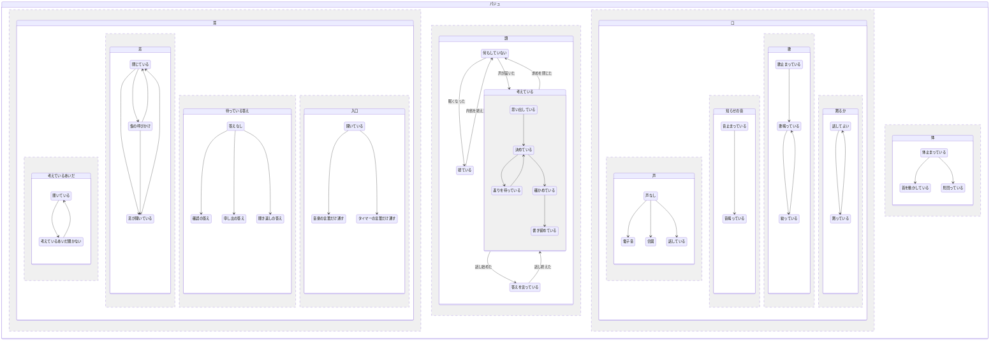
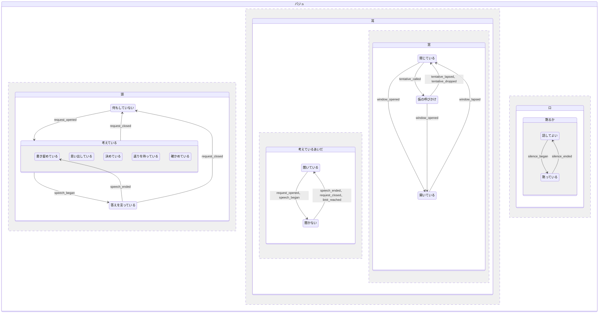

# familiar-ai 設計方針：パジュの状態（v0.5）

> **パジュの状態**（耳、頭、口、体がいま何をしているか）を、1 つの状態図で持つための設計方針（環-aw、2026-11-04〜12、本人の決定ア〜ヲ）。
> **頭、耳の考えているあいだと窓、口の黙るかは実装した**（環-aw 第 1 段、2026-11-08〜10、`f920f53d`〜`175d7a1c`。第 2 段、2026-11-12、`c6b3a279`〜`10c3195c`。状態図は `loop/paju_state.py` の `PajuState`）。寝ている、体、耳の待っている答えと入口、口の声と知らせの音と歌はこれから作る。表の「いまの持ち主」は、v0.5 で直した行（窓、仮の呼びかけ、黙っている）が 2026-11-12 のコード（v0.10c31）、ほかの行が 2026-11-11 のコード（v0.3b5a7）の事実である。
> 本人の指示は「パジュにたった一つの状態を持たせてください。そして、さまざまなイベントに対して、状態の変化を管理するようにしてください」「この仕組みは claude.md に記載する根源的な仕組みにしなさい」。

## 1. 1 つの状態図にする理由

パジュの状態は、状態図を作る前は別々の器に散らばっていた。黙る依頼は `agent_state` の `silence_request`、名前で開く窓は `WakeWindow`、仮の呼びかけは `_tentative_call`、考えているあいだ聞かないことは電子音の仕事が生きているか（v0.3 までの `_deaf_while_beeping`、第 1 段で撤去）、調べもの中は `Lookup.in_flight`、確認待ちは `confirm_frame` が持っていた。縛り合う 2 つの状態は、片方の持ち主がもう片方を覗いて合わせている。頭、耳、黙る依頼を状態図へ移したいまも、ほかの器（調べもの中、確認待ちなど）は残っている。

このため、どちらかが先に変わると、そのあいだだけ 2 つが食い違う。§5 の 6 件は、どれもこの食い違いが実機で表に出たものである。たとえば 10/18 には、確認を聞き返しているあいだに窓が閉じ、名前の無い「はい」が捨てられた。

そこで、パジュの状態を 1 つの**状態図**（Statecharts）にまとめ、状態を変えるのは**事象**だけにする。事象とは、パジュの状態を移すもの（声が届いた、話し終えた、タイマーが鳴った、など）である。状態図の書き方は Harel（1987）が考え、W3C SCXML が決まりにした[^statecharts]。

[^statecharts]: D. Harel, "Statecharts: A Visual Formalism for Complex Systems", Science of Computer Programming 8 (1987)。W3C, "State Chart XML (SCXML): State Machine Notation for Control Abstraction" (2015)。仕組みの先例は `モジュール分割設計` v0.43 の行 271 にある。

## 2. 状態図の形

状態図は、同時に動く 4 つの**並行の領域**（耳、頭、口、体）を持つ。**領域**は、同時にどれか 1 つの状態だけを取る区切りである（決定ア、イ、ウ）。耳と口の中は、さらに**入れ子の領域**に分ける。耳は考えているあいだ、窓、待っている答え、入口の 4 つ、口は声、知らせの音、歌、黙るかの 4 つである（決定オ、ネ。v0.5 で聞き方を考えているあいだと窓に分け、黙っているを口の黙るかへ移した）。

状態図は `python-statemachine` の `StateChart` で書く（決定ス）。この検討のあいだに、版 3.2.2 で並行の領域と入れ子を一度きりの試しで書き、動くことを確かめた。入るときの動作の中で待っているあいだも、外から今の状態を読めた。遅れて起こす事象（`send` の `delay`）は、裏の仕事として送れば `cancel_event` で取り消せた（`await` で直に送ると、遅れのぶん送った側が止まる）。第 1 段で、承認を得て依存に足した（`pyproject.toml` の `python-statemachine==3.2.2`）。

図の状態名のうち「答えなし」「声なし」「音止まっている」「音鳴っている」「歌止まっている」「歌鳴っている」「体止まっている」は、図の上で名前が重ならないように付けたもので、表の「なし」「止まっている」「鳴っている」と同じ状態である。図には戻りの移りを一部しか書いていない。移りの全部は §3 の表に書く。

領域どうしの同期は、Statecharts の決まりにそろえる（決定エ）。

- **一斉配信**：1 つの事象を、すべての領域へ同時に届ける。
- **移りの中で事象を起こす**：移りの途中で新しい事象を起こし、ほかの領域を動かす。
- **一歩を最後まで**：1 つの事象による移りを全部やり終えてから、次の事象を受ける。途中の食い違った状態は、外から見えない。
- **入るときの動作、出るときの動作**：ある状態に入るとき、出るときに、必ず行う動作。
- **禁止の条件**：ほかの領域の状態を見て、移りを止める条件。ほかの領域を条件に見るのは、禁止のときだけにする。

状態図が移りを持たずに捨てた事象は、事象の名前と、そのときの各領域の状態を 1 行ログに残す（決定ユ）。ふだんは情報の段（`info`）で書き、1 秒ごとの見張りのように頻繁な事象は開発者向けの段（`debug`）にする。言葉の中身は書かない。

長い仕事は、入るときの動作の中で待つ（決定セ。ただし第 1 段の実装では、入るときの動作から立てる仕事を外の仕事にし、中では待たない。§2.1）。待っているあいだは状態図全体が止まり、そのあいだに届いた事象は、仕事を終えてから順に処理される（同じ一度きりの試しで確かめた）。

周りの事実は、状態図の状態にしない。移りを決める条件として読む（決定ア）。周りの事実は、タイマーが動いているか、在席と顔ぶれといまの話者（話者は 60 秒で切れる）、静穏時間、夜、カメラが使えるか、である。気分（P、A、Dom）と欲求（SEEKING、REST、BOND など）は数値なので、これも状態にしない。

### 2.1 実装した頭、耳、口

第 1 段と第 2 段で実装した状態図（`PajuState`）は、頭、耳、口の 3 つの並行の領域を持つ。耳は考えているあいだと窓の 2 つの並行の領域を持ち、口はいまは黙るかの 1 つの領域だけを持つ。

頭と、耳の考えているあいだを動かす事象は次のとおりである（第 1 段）。表の「耳」は、考えているあいだの領域を指す。

| 事象 | 送る所 | 頭 | 耳 |
|---|---|---|---|
| `request_opened` | 求めを開いたとき | 何もしていない → 考えている（子は思い出している） | 聞いている → 聞かない |
| `recall_began`、`decide_began`、`wait_began`、`check_began`、`note_began` | メインのループの段に入るとき | 考えているの中で、その子へ移る | 移らない |
| `speech_began` | 答えの声を出し始めるとき | 考えている → 答えを言っている | 聞いている → 聞かない |
| `speech_ended` | 答えの声を言い終えたとき（再生に失敗したときも） | 答えを言っている → 書き留めている | 聞かない → 聞いている |
| `request_closed` | 求めを閉じたとき。例外や中断で閉じる所に届かなかったときも送る（`_hear_again`） | 何もしていないへ | 聞かない → 聞いている |
| `limit_reached` | 考えているが上限に届いたとき、電子音を鳴らせなかったとき | 移らない | 聞かない → 聞いている |

頭が答えのあとに考えているへ戻っても、耳は聞いたままにする（決定モ）。耳を頭に入るときの動作で動かさず、事象で動かすのはこのためである（考えているに入るときの動作で耳を閉じると、書き留めているあいだに届いた声を捨ててしまう）。

入るときの動作は 2 つある。考えているの子に入ると、電子音の仕事を立てる（立っていれば何もしない、§3.3）。何もしていないに入ると、電子音の仕事を片付け、鳴らした回数を 0 に戻す（`_on_head_idle`）。電子音を片付けるのは、求めの閉じ方によらず、状態の移りである。考えているの合計を数える仕事も、入るときの動作から立てる（§3.4）。

入るときの動作から立てる仕事（電子音、数える仕事）は、状態図の処理の文脈を受け継がない形で立てる（`core/aio.spawn_outside`）。受け継ぐと、その仕事が送った事象に待つ口が付かず、列に残る。このため長い仕事は、決定セの「入るときの動作の中で待つ」形ではなく、外の仕事として立てている。答えの声も、入るときの動作の中では待たず、声を出す口（`_say_aloud`）が `speech_began` と `speech_ended` を送る。

送る口は `fire` の 1 つである（ループからは `_to_state`）。状態図が落ちても、会話は止めず、警告を 1 行残す。移りの無い事象は捨て、事象の名前と各領域の状態を 1 行残す（決定ユ）。耳がもう聞いているときは、数える仕事も電子音の仕事も `limit_reached` を送らない。移りの無い事象を送ると、ライブラリがそのとき列に待っていたほかの事象も退けて、列を空にするからである。

窓と黙るかを動かす事象は次のとおりである（第 2 段）。同じ状態へ戻る移りは、外へ出て入り直す形にした[^itself]。

| 事象 | 送る所 | 移り |
|---|---|---|
| `window_opened` | 窓を開けたとき（名前、キーボード、確認の問いか名前つきの求めの返事を言い終えた、名前つきの解く言葉）と、延ばしたとき、話し終えたときに、データの上で窓が開いていれば | 閉じている、仮の呼びかけ → 開いている（開いているからは入り直す） |
| `window_lapsed` | 窓の時間を数える仕事が、切れたとき | 開いている → 閉じている |
| `tentative_called` | 名前だけで確かさの足りない声が届いたとき（状態が開いていなければ） | 閉じている → 仮の呼びかけ（仮の呼びかけからは入り直す） |
| `tentative_lapsed` | 仮の呼びかけの 10 秒を数える仕事が、切れたとき | 仮の呼びかけ → 閉じている |
| `tentative_dropped` | 鳴っているあいだの音楽の言葉を、窓を開けずに受けたとき | 仮の呼びかけ → 閉じている |
| `silence_began` | 黙る依頼を受けたとき（「黙って」、タイマー）と、再起動で控えを戻したとき | 話してよい → 黙っている（黙っているからは入り直す） |
| `silence_ended` | 名前つきの「話していいよ」、止めたタイマー、期限 | 黙っている → 話してよい |

[^itself]: `python-statemachine` 3.2.2 の `internal=True` の形では、並行の領域の中で、ほかの領域の状態が二重になった（2026-11-12 の一度きりの試し）。このため `x.to.itself()` の形にした。

窓、仮の呼びかけ、黙るかは、状態とデータの両方を持つ。データは、窓が `WakeWindow`（`PajuState.wake`）、仮の呼びかけが届いた時刻（`tentative_at`）、黙るかが依頼（`SilenceRequest`、`silence`）である。門は状態ではなくデータで決める。窓の中だったかと、仮の呼びかけの続きかは、届いた時刻（声なら話し始め）で決め、黙っているかは処理した時刻で決める。このため、切れる直前に話し始めた声は、状態が閉じているへ移ったあとでも、同じ窓の会話として受ける。状態は、移りとログ（`describe` の「頭=… 耳=…/窓=… 口=…」）のために持つ。

データを変えるのは状態図の口だけで、口が事象を送る。

- **窓**：`open_window`（開ける）、`extend_window`（延ばす）、`hold_window`（話し始め）、`release_window`（話し終わり）。読む口は `window_open_at`。
- **仮の呼びかけ**：`call_tentatively`（預ける）、`drop_tentative`（捨てる）。読む口は `tentative_since`。
- **黙るか**：`hush_with`（黙る）、`unhush`（解く）。読む口は `silence_request` と `is_silent`。

窓のデータを `window`、黙る口を `hush` と名付けなかったのは、領域の名前と重なり、ライブラリが許さないからである。

時間で切れる 3 つの移り（窓、仮の呼びかけ、黙るの期限）は、状態図の中の数える仕事が送る（決定ヰ）。送る前に状態を見る。移りの無い事象を送ると、ライブラリがそのとき列に待っていたほかの事象も退けるからである。送っているあいだは仕事を止めず（送っているあいだの印）、送り終えたらデータを見て、まだ生きていれば元の状態へ戻す。窓が切れたとき、窓が開いているあいだに届いた仮の呼びかけがまだ生きていれば、仮の呼びかけへ移す。期限で解けたことを送れずに、データが無いのに黙っているに残ったときは、次の `unhush` で話してよいへ戻す。ループを閉じるときは、数える仕事をみな止める（`end_timers`）。

黙っている依頼の持ち主は状態図で、DB の `agent_state` の `silence_request` の行は、再起動で消えないための控えである（決定ヱ）。黙っているに入ると控えを書き（`save_silence`）、出ると消す（`clear_silence`。タイマー由来の依頼も、期限で消す）。`start` で初めの状態に入ったあと、控えを 1 度だけ戻す。生きていれば残りの期限で黙り、過ぎていれば控えを消す。

`start` を待ってから読む読み手は、門、トニック（残高切れの知らせ）、黙る口と解く口（`hush_with`、`unhush`）、タイマーの沈黙を掛ける口と解く口（`agent._hush_for_timer`、`_unhush_timer`）、「話していいよ」の口（`_release_silence`）である。同時に待つ読み手も、戻し終えるまで待つ。戻しが途中で落ちたら、待っていた読み手が戻し直す。ほかの事象でひとりでに初めの状態に入っていても、初めての `start` で戻す。タイマーを掛ける前の確かめ（`agent._silence_active_now`）と調停へ渡す一行（`_silence_note`）は、`start` を待たずに読む。どちらも求めの中で読まれ、求めは開くときに `start` を待つ（`_begin_request` が `request_opened` を送るとき）ので、戻し終えたあとに読まれる。

状態図は、ループを作った時点で作り、`agent.paju_state` に置く。文字コマンド（`/timer stop`）は門より前に agent が直に処理し、止めたタイマーの沈黙を状態図で解くので、最初の入力を待って作ると、状態図が無く控えが残った（第 2 段で起き、直した）。文字コマンドそのものは状態図の外にある。作れなくても会話は止めず、初めて使うときに作り直す。

## 3. 領域ごとの状態

### 3.1 耳

耳は、入れ子の領域「考えているあいだ」「窓」「待っている答え」「入口」を持つ（決定ネ。v0.5 で聞き方を考えているあいだと窓に分け、黙っているを口へ移した）。

| 領域 | 状態 | いまの持ち主 | 入る、抜ける |
|---|---|---|---|
| 考えているあいだ | 聞いている | 状態図の耳の `hearing`（`loop/paju_state.py`） | 聞かないから、言い終える、求めを閉じる、上限に届くと戻る |
| 考えているあいだ | 考えているあいだ聞かない | 状態図の耳の `deaf`（`loop/paju_state.py`）。声を捨てるかは `_deaf_to`（`loop/event_loop.py:1890`）が判定する | 求めを開くか、答えの声を出し始めると入る。言い終える、求めを閉じる、上限に届くと抜ける（§2.1） |
| 窓 | 閉じている | 状態図の窓の `shut` | 窓が切れる、仮の呼びかけが切れるか捨てると戻る |
| 窓 | 窓が開いている | 状態図の窓の `open`。データは `WakeWindow`（`PajuState.wake`。長さ 10 秒は `core/wake_window.py` の `WAKE_WINDOW_SEC`） | 名前で呼ばれる、打たれる、確認の問いか名前つきの求めの返事を言い終えると開く。話し終わってから 10 秒で閉じる |
| 窓 | 仮の呼びかけ | 状態図の窓の `tentative`。データは届いた時刻（`PajuState.tentative_at`） | 値の足りない名前だけの声で入る。届いた時刻から 10 秒で閉じているへ戻る。窓が開くと開いているへ移る |
| 待っている答え | なし | なし | 待っている答えが閉じると戻る |
| 待っている答え | 確認の答え | `confirm_frame`（`agent.py:869` の `confirm_alive`、生きるのは 300 秒） | 確認の問いを言うと入る |
| 待っている答え | 申し出の答え | `_offer`（`loop/event_loop.py:936`、読むのは 4444） | 申し出を言うと入る |
| 待っている答え | 聞き返しの答え | `_heard_check`（`loop/event_loop.py:934`、読むのは 4422 の `_take_heard_check`、生きるのは 257 の `HEARD_CHECK_TTL_SEC` の 30 秒） | 聞き取りを確かめる問いを言うと入る。30 秒で戻る（決定ラ） |
| 入口 | 開いている | なし | どちらの門も閉じていないとき |
| 入口 | 音楽の言葉だけ通す | `mic_gate_reason`（`agent.py:842`）、門は `realtime_stt_session.py:409-454` | パジュがかけた音楽が鳴ると入る。止まると抜ける |
| 入口 | タイマーの言葉だけ通す | `TimerTool.listening_closed`（`tools/timer.py:164`） | タイマーが動き始めると入る。鳴る、一時停止する、取り消す、`/mic on` で抜ける |

**仮の呼びかけ**は、名前だけで確かさが足りなかった声（1 字違いの名前だけの声も）の届いた時刻を預ける状態である（知-bs）。10 秒は届いた時刻から数え、状態が閉じているへ戻ったあとも、届いた時刻が 10 秒のうちなら、続く名前の無い声を宛先の判定に回す。預かりは、窓が開いても、続きとして受けても捨てない（決定ヲ）。窓のあいだは門が窓で受けるので、預かりは使われないからである。捨てるのは、鳴っているあいだの音楽の言葉を、窓を開けずに受けたときだけである。残すと、残りの 10 秒に届いたテレビの声にも、頭に名前を付けて宛先を聞いてしまう。

黙っているは、v0.5 で口の黙るかへ移した（§3.5）。黙っているあいだも耳は聞いていて、答えを声にしないだけだからである。黙っているあいだも窓は閉じない。名前の無い言葉に答えないのは、門が窓より先に黙っているかを見て、解く言葉でなければ控えるからである（決定ヘ、`_swallow_if_unheard`）。黙っているあいだに門が窓を開けるのは、名前と一緒に言われた解く言葉（タイマー由来の沈黙なら、名前つきの操作の言葉）を聞いたときだけである（決定ケ）。名前だけの呼びかけでは窓を開けず、仮の呼びかけとしても預けない。ただし、窓が開いたまま黙っていることはよくある。窓の中で「パジュ、黙って」と言われると、窓は開いたまま黙っているに入り、名前つきの求めの返事を言い終えると窓を開け直すからである（`_speak` の終わり）。タイマーで黙っているあいだの「パジュ、止めて」と、名前つきの「話していいよ」で調停が解くと決めるより前も、窓が開いたまま黙っている。

**待っている答え**は、パジュが問いを言って、家族の答えを待っているあいだの領域である（決定ノ）。問いは 1 つだけ待ち、新しい問いを言ったら前の問いを上書きする。確認の答えを待っているあいだは、頭が考えていても、その答えを聞く。

**入口**は、マイクで受けた言葉を、頭へ渡す前に門で絞る領域である（決定ハ）。いまはタイマーの門が `timer_mic_close`（`config.py:762`、既定は真）で効き、動いているタイマーが 1 本でもあるあいだ閉じる。鳴った時点で「鳴った」の印が付くので、鳴っている 30 秒のあいだは開いている。ストップウォッチには門が無い。

どちらの門も、名前で始まる言葉を通す。音楽の門はいまも通しているが、タイマーの門はいまは名前を見ず、止める言葉（12 文字以下で「止め」「ストップ」「中止」「やめ」「一時停止」「再開」のどれかを含む、`core/timer_rules.py:52`）だけを通している。このため 10 分のタイマーなら、10 分のあいだ「パジュ、あと何分？」が門で落ちていた。名前で始まる言葉を通すのは、タイマーの門では新しい動きである。2 つの門が重なったときは、いまと同じく音楽の門を先にする。

家族のどちらの答えかを確かめる仕事（家族どうしの話か、1 字違いの名前か）は、頭ではなく耳の仕事とする（決定ヒ）。声を列に積む前の `push_utterance` から `_swallow_if_unheard`（`loop/event_loop.py:5052`）で行い、メインのループの外で動いているからである。この仕事は、届いた声 1 つを門で判定するだけで、続いて保つものが無いので、状態にはしない。

### 3.2 頭

頭は、メインのループでいま何を処理しているかで状態を決める（決定ソ）。メインのループが投げて待たない仕事（主LLM、調べもの、カメラ）は、頭の状態にしない。投げた仕事を待っているあいだ、メインのループはほかの事象を処理できる（`_dispatch_main_llm`、`loop/event_loop.py:1945` は待たずに戻る）。

| 状態 | いまの持ち主（`loop/event_loop.py` の行。ほかは file 名を書く） |
|---|---|
| 何もしていない | 状態図の頭の `idle`（`loop/paju_state.py`） |
| 考えている | 状態図の頭の `thinking`。開いている求め（`_take_trigger`、3839 から、求めを閉じるまで）と同じ長さ |
| 答えを言っている | 状態図の頭の `answering`。声は `_speak`（4965）、`_say_aloud`（5875） |
| 寝ている | 内省（`loop/rest.py`、起動は `loop/tonic.py:488-493`）。状態図にはまだ無い |

**考えている**は、外からの刺激で求めを開いてから閉じるまでの状態である（決定タ）。外からの刺激は、声、キーボード、機器の知らせである。情動から来た求めは内からの刺激だが、家族に向けて話す求めなので考えているに入れる。主LLM の返りを待っているあいだも、求めが開いているので考えているに含める。

考えているは、メインのループの段ごとに 5 つの子の状態を持つ（決定チ）。名前は仮である。

| 子の状態 | いまの持ち主 | 測った時間（11/04〜06 のログ） |
|---|---|---|
| 思い出している | `loop/iteration.py` の `_intake`、`_recall_at`（3016）。`recall_began` は 2802 | 取込は中央 0.04 秒、90 % で 0.35 秒（145 回）。想起は中央 0.31 秒、90 % で 0.65 秒（142 回） |
| 決めている | `loop/iteration.py` の `_decide`。`decide_began` は 4234 | 中央 1.00 秒、90 % で 1.39 秒、最大 2.41 秒（143 回） |
| 返りを待っている | `_take_trigger`（3839）で、投げた仕事の返りを待つ繰り返し。`wait_began` は 3927 | 返りによる |
| 確かめている | `_speech_check_violation`（4745）。`check_began` は 4768 | 0.21 秒（1 回だけ） |
| 書き留めている | `_close_final`（1072）、`_write_version_later`（1305）、`_spawn_final`（1166）、`_fold_told`（1540）。`note_began` は 6445。答えを言い終えたときは `speech_ended` でここへ入る | 最終版の要約は 42 回中 7 回で動き、1 回 2.0〜10.2 秒 |

**書き留めている**は、版の保存と最終版を書いているあいだである（決定カ、キ）。v0.1 では寝ているに入れていたが、外からの刺激で開いた求めの続きなので、考えているの子に移した。言ったことの畳み（`_fold_told`）は、その求めと同じ状態を取るので、実際にはいつも考えているの中にある。

**答えを言っている**は、考えているの子ではなく、兄弟の状態である（決定ツ）。声を出す口（`_say_aloud`）が、声を出す前に「話し始めた」（`speech_began`）を、言い終えたら「話し終えた」（`speech_ended`）を送る。再生に失敗したときも「話し終えた」を送る。言い終えると考えているの子の書き留めているへ戻り、求めを閉じると何もしていないへ移る。

**寝ている**は、内からの刺激で動く仕事をしているあいだで、いまは内省だけである（決定ナ）。自律機構（Tonic）が「眠くなった」を起こし、頭は何もしていないからだけ寝ているへ移る。考えているか答えを言っているときに届いた「眠くなった」は、求めを閉じるまで持ち越す。入るときの動作で `run_rest_pass` を待ち、内省の層を全部終えてから何もしていないへ戻る。

内省は、いまも自律機構の輪を止めて動く（`loop/tonic.py:492` の `await run_rest_pass`）。寝ているは、まだ状態図に入れていない。このため、内省のあいだタイマーの見張りなどが最大約 2 分半遅れることは、いまも起きている。寝ているを状態図に入れても、この遅れは変わらない。

寝ているあいだは、声もキーボードで打った言葉も、すべて捨てる（決定ク）。預からないので、内省を終えたあとに答えることもない。

### 3.3 考えているあいだの声と電子音

考えているあいだは、電子音を鳴らす（決定テ）。届いた声を捨てるのは、答えより前の考えているあいだと、答えを言っているあいだである（決定ト、モ）。電子音は、求めの出どころ（声、キーボード、情動、機器）によらず鳴らし、答えのあとの書き留めのあいだも鳴らす。鳴らすのは、考えているの子に入るときの動作が立てる 1 本の仕事（`_beep_while_waiting`、`loop/event_loop.py:1851`）である。仕事は 1 秒ごと（`config` の `wait_beep_interval_seconds`）に、そのときの子の音を 1 回鳴らす。音楽は絞らない。合図の声が鳴っているか準備中のあいだは休む。

鳴らす音は、考えているの子ごとに 1 つずつの 5 種類である（決定レ）。高さは、ドを 523.25 Hz に置いた純正律のハ長調の 1 つの音階から取った（2026-11-09、本人が聞いて決めた）。一瞬で終わる段は和音、時間のかかる段は単音にし、段から段へ高さがつながるようにした。大きさは、振幅 0.15 を基にした dB である。音は `scripts/gen_reaction_sounds.py` が作り、子と音の対応は `core/reaction_cue.py:34` の `BEEP_WAVS` にある。

| 子の状態 | 高さ | 形 | 長さ | 大きさ |
|---|---|---|---|---|
| 思い出している | ド、ミ、ソの和音 | だんだん消える | 0.40 秒 | −1 dB |
| 決めている | ド（機械音 A と同じ音） | 平ら | 0.08 秒 | −6 dB |
| 返りを待っている | ミ | 平ら | 0.06 秒 | −6 dB |
| 確かめている | ド、ミ、ソの和音（効果音 B と同じ音） | 平ら | 0.12 秒 | −1 dB |
| 書き留めている | 1 つ下のド | 平ら | 0.12 秒 | −24 dB |

「平ら」は、5 ms で立ち上がり、長さの 15 % に 5 ms を足した長さで絞って終わる形である。「だんだん消える」は、鳴らした瞬間がいちばん大きく、長さの 4 分の 1 ごとに 1/e へ減る形である。書き留めているの音は −24 dB と小さくし、目立たないものにした（決定ヤ）。合図の後で黙ると決まったときの黙る音（`react_silent.wav`）は、1 つ下のド、ミ、ソを 0.15 秒、さらに低いラ、ド、ミを 0.40 秒、だんだん消える形で鳴らし、大きさは振幅 0.35 を基に −6 dB である。

電子音は状態に従う（決定ロ）。考えているの子に入ると鳴り始め、頭が何もしていないに入ると片付く（§2.1）。答えの声を出し始めるときも止める（`_speak` が `_stop_beeps` を呼ぶ、`loop/event_loop.py:4995`）。黙ると決めたあとも、頭が書き留めているにいるあいだは、書き留めているの音が鳴る。

人が居なくて声を出さない求めでは、電子音を鳴らさない（決定ロ）。声を出さない求めは、情動と機器の求めで、届け先の門（`_delivery_block_reason`、`loop/event_loop.py:5008`）が理由を返すものである。本人の言葉は「口が、相手がいなければ動かないというルール」である。声とキーボードの求めには門が理由を返さないので、いつも鳴らす。

電子音を鳴らせなかったときは、仕事を終え、耳を聞く側へ戻す（`limit_reached` を送る、決定ミ）。再生の口が例外を出したときだけでなく、偽を返したときも、鳴らせなかったとみなす。鳴らせなかった仕事は、答えを言い始めるか何もしていないに入るまで残すので、そのあいだに次の子へ入っても立て直さない。答えのあとの書き留めているでは、もう 1 度だけ鳴らしてみる。耳がもう聞いているとき（答えのあとの書き留めているあいだ）は、`limit_reached` を送らない。鳴らせなくても、求めは閉じない（§3.4）。

答えを言っているあいだは、電子音を鳴らさない。声が再生の鍵を持っているからである（`tools/tts.py:1331` の `_PLAYBACK_LOCK`）。

答えより前の考えているあいだも、次の 3 つは捨てない（決定ト）。

- 確認の問いへの答え（待っている答えが確認の答えのとき）。
- タイマーかアラームの音が鳴っている最中の、名前つきの操作の言葉（新しい動き）。
- キーボードで打った言葉。

答えを言っているあいだは、キーボードで打った言葉と確認の答えを列に積み、ほかの声は捨てる（決定モ）。確認の問いを言い終える前に届いた答えも受ける。鳴っている最中の操作の言葉は、声が再生の鍵を持っているあいだは知らせの音が鳴らないので、このあいだには起きない。

答えを言い終えて考えているへ戻ったあと（書き留めているあいだ）に届いた声は、捨てずに列に積み、求めを閉じてから新しい求めとして答える（決定モ）。電子音は鳴らしたままにするので、このあいだの電子音は、声を受けないことではなく、考えていることだけを知らせる。

考えているあいだに届いて捨てなかった声（耳が聞いているときの声と、上の例外）は、求めが開いているあいだは、名前があってもなくても割り込まない（決定ホ、リ）。新しい求めを始めると、前の求めの状態が空になり、届く結果の行き場が無くなって、打ち切りと同じになるからである。打ち切るのは停止ボタンだけである（`abort_current`、`loop/event_loop.py:3600`。中で `_abort_lookups` を使う）。第 1 段までは、名前つきの声が届くと調べかけを打ち切り、新しい求めを開いていた。

届いた声の扱いは、そのとき何を待っているかと、求めの出どころで分かれる（`_take_trigger`、`loop/event_loop.py:3839`）。

| そのとき | 会話の求め（人の言葉から始まった求め） | 情動、機器の求め |
|---|---|---|
| 主LLM が考えている | 保留箱で待たせ、主LLM の返りが来たときに、考え直すかそのまま言うかを Jev が決める（`_rethink_or_speak`、4009） | 保留箱で待たせ、求めを閉じてから新しい求めとして答える |
| 調べものだけが動いている | 取り出して、前の求めに添える（`_attach_to_request`）。W の作業状態の枠に「言い足したこと」として載る | 保留箱で待たせ、求めを閉じてから新しい求めとして答える |

情動と機器の求めに添えないのは、どちらも添えた言葉に答えが返らないおそれがあるからである（2026-11-10、本人の決定）。情動の求めは人と話していなければ声にせず、機器の求めは W に「人の言葉ではない」と書く。会話の求めかは、求めを始めたきっかけが発話かで決める（`_joins_words`、3996）。確認の答えを待っているあいだの返事は、主LLM が考えている最中でなければ、どちらの求めでも、いままでどおり取り出して確認の答えにする。主LLM が考えている最中なら、ほかの言葉と同じく待たせる。

考え直すときは、主LLM の返りを声にせず、待っていた言葉を前の求めに添え、返りを下書きとして W に載せて決め直す（`_rethink`）。Jev が使えないときと確信度が低いときは、そのまま言うほうへ倒す。そのときと、そのまま言うと決めたときは、待っていた言葉は答えのあとに新しい求めになる。

この形の帰結として、情動の求め（絆など）でパジュが話しかけたことへの返事も、その求めが閉じるまで待つ（話し終えると耳は聞いているに戻るので、返事は捨てられずに届き、保留箱で待つ）。一方、声を出さない情動の求め（見回りなど）のあいだは、耳が聞かないにいるので、音楽を止める「ストップ」も、名前つきであっても捨てる（鳴っている最中の名前つきの言葉だけは通す）。

答えのあとまで待たせた言葉には、そのことを W に書く（決定ル）。書くのは、何秒前に届き、答えのあとまで待たせたか（`workspace.WAITED_NOTE`）と、届いたときに鳴っていたタイマーかアラームの音がもう鳴り終わっていること（`workspace.RING_OVER`）である。前の求めに添えた言葉のうち、届いたときに鳴っていたものにも、鳴り終わったことを書く。`WAITED_NOTE` の文は「前の求めに答えているあいだに届き」だが、声を出さなかった情動の求めのあいだに届いた言葉にも同じ文を付けるので、そのときは文の表す場面と合わない。

寝ているあいだには、この 3 つの例外を当てない（決定ク）。寝ているあいだにキーボードで打たれた言葉も、画面で知らせずに捨てる（決定ヨ）。

### 3.4 考えているの上限と、時間切れの答え

**考えているの上限**は、聞かない時間が長く続かないように置く時間である（決定ミ）。求めを開いてからの合計で 3 分（`config` の `thinking_limit_sec` = 180.0）とし、投げた仕事（調べもの、主LLM、深く調べるLLM）を待つ時間も含める。答えを言い始めたら、その求めではもう数えない（決定ワ）。答えたあとの書き留めは、3 分を過ぎてもよいからである（2026-11-10、本人の決定）。名前で割り込めなくなったので（決定ホ）、上限は、考えているから抜けられなくなったときにパジュが聞く側へ戻る、ただ 1 つの道になる。第 1 段までの上限は 5 分（`DEAF_IDLE_LIMIT_SEC`、撤去した）で、何も待っていない時間だけを数えていた。

数えるのは状態図の中である（`PajuState` の `_count_limit`）。考えているに入ると数え始め、何もしていないに入ると初めに戻す。残り時間は状態図の中だけで持ち、届くのは 1 つの求めで 1 回だけである。届いたら、耳が聞かないにいれば `limit_reached` を送って聞く側へ戻し、耳によらずループへ知らせる（`on_limit`、ループは `_tell_timed_out` で列に「時間切れ」のきっかけを積む）。ループを閉じるときは、初めに数えるのをやめる（`end_counting`）。

投げた仕事にも、それぞれ待つ上限を置く（決定マ）。主LLM の 1 回は 60 秒（`config` の `main_llm_timeout_sec` = 60.0。第 1 段までは定数 `MAIN_LLM_TIMEOUT_SEC` の 600 秒で、撤去した）、深く調べるLLM はいまと同じ 120 秒（`config.py:869` の `deep_timeout_sec`）である。主LLM が 60 秒で切れると、返りに時間切れの印（`stop_reason` が `MAIN_LLM_TIMED_OUT`）を付け、それまでに流れてきた文を添える。主LLM の呼び出しが例外で終わったときは、印を付けず、いままでどおり空の返りで沈黙して閉じる。

主LLM の 60 秒か考えているの 3 分で切ったら、時間切れの答えを言う（決定ム、`_answer_timed_out`、`loop/event_loop.py:3420`）。手順は次のとおりである。

1. 届いていた結果を下書きに集める。届いていて取り込んでいない完了も、下書きにしてから捨てる。
2. 動いている主LLM と調べものを止める。
3. 軽量LLM が「考えすぎてよく分からなくなった」を前置きに、下書きから答えを書く。下書きは、前の回の主LLM の返り、届いた調べものの結果、時間切れの回で流れてきた文（`stream_turn` の `on_text`）である。下書きが何も無いときは、家族の言葉だけを渡す。待つのは `config` の `timeout_answer_wait_sec`（5.0 秒）までで、内省の調整の対象にしない。
4. 言う前の検査に掛ける（決定メ）。
5. 言って求めを閉じる。最終版と終了のログに時間切れと書く。深く調べるかの申し出はしない。

軽量LLM が書けなかったときは、クレジット切れと同じ形の録音「時間内に答えをまとめられませんでした。」を鳴らす（`core/reaction_cue.py` の `TIMEOUT_WORDS`、録音は `sounds/timeout_answer.wav` と声ごとのフォルダ、−26.1 dB）。鳴らせなければ黙って閉じる。言い直しが時間切れになったときは、元の答えを言い、最終版と終了のログに時間切れと書く。

軽量LLM の答えにも、言う前の検査をかける（決定メ）。違反が出ても言い直させる相手がいないので、そのまま言い、違反したことを固定の文と数だけでログに残す。

上限に届いたときは、時間切れの答えを言ってから求めを閉じる（決定ミ）。電子音の仕事が失敗したときは、求めを閉じず、耳を聞く側へ戻すだけにする（決定ワ）。

### 3.5 口

口は、入れ子の領域「声」「知らせの音」「歌」「黙るか」を持つ（決定オ、ニ。v0.5 で黙るかを足した）。

| 領域 | 状態 | いまの持ち主（`loop/event_loop.py` の行。ほかは file 名を書く） |
|---|---|---|
| 声 | なし | なし |
| 声 | 電子音 | `_beep_while_waiting`（1851）。立てるのは状態図の入るときの動作（§2.1、§3.3） |
| 声 | 合図 | `_ReactionCue`（6546）、`core/reaction_cue.py:65` の `cue_for` |
| 声 | 話している | `_speak`（4965）、`_say_aloud`（5875） |
| 知らせの音 | 止まっている | なし |
| 知らせの音 | 鳴っている | `io/dif.py:259-329`（`ring` と `_ring`。30 秒。最初の 8 秒は大きく、25 秒までは 0.1 倍に絞り、そのあと大きく戻す）、`loop/timer_watch.py:47`、`loop/alarm_watch.py:40` |
| 歌 | 止まっている | `_music_status`（3769）が毎回、再生の機器から読む |
| 歌 | 鳴っている | 同上 |
| 歌 | 絞っている | `loop/music_watch.py:48` の `duck_while_speaking` |
| 黙るか | 話してよい | 状態図の口の `may_speak`（`loop/paju_state.py`） |
| 黙るか | 黙っている | 状態図の口の `silent`。データは依頼（`SilenceRequest`、`PajuState.silence`）。控えは `agent_state` の `silence_request`（`silence_state.py`） |

**知らせの音**は、タイマーとアラームが鳴らす音の領域である（決定ニ）。v0.1 では声の状態にしていたが、声と並んで動くので領域を分けた。声と知らせの音は、いまと同じく再生の鍵（`_PLAYBACK_LOCK`）で交互に鳴り、声が先に鍵を取る。10/17 21:40 には、タイマーが鳴り始めて 1.85 秒後に声が鳴った。

**黙るか**は、黙る依頼を受けているかの領域である。調停が読んだ「黙って」かタイマーで黙っているに入り、期限、名前つきの「話していいよ」、止めたタイマーで話してよいへ戻る。どの依頼にするかは、いまと同じく `silence_state` の純関数で決める。タイマーは人の依頼を上書きせず、遅いタイマーは期限を延ばし、止めたタイマーの id が合うときだけ解く。「話していいよ」は、タイマーの沈黙を解かない。

**歌**は、パジュがかけた音楽が鳴っている領域で、音の中で一番うしろに置く（決定ヌ）。声が話しているか、知らせの音が鳴っているあいだは絞り、両方が終わったら戻す。知らせの音で絞るのは新しい動きである。戻すのは、いまと同じく `RESTORE_AFTER_SEC` だけ待ってからにする（すぐ戻すと、続けて話すたびに音量が上下する）。合図と電子音では絞らない。家族が再生の機器で直接かけた曲は、歌に入れない（決定フ、いまと同じく `_music_status` は空を返す）。

### 3.6 体

| 状態 | 文書 | 入る、抜ける |
|---|---|---|
| 止まっている | なし | なし |
| 首を動かしている | `設計図_Mermaid` の [D-向き]、`設計詳細_活性_O書込_知覚在席` v0.41 | `look` や見回りの 1 歩で入る。揺れが収まると抜ける |
| 見回っている | ユースケース③ v0.5 | 欲求の発火で入る。1 歩終わる、人が来る、話しかけられると抜ける |

## 4. 縛り合う組と同期

「同期の与え方」の列は、決定エの決まりを組ごとに当てはめたものである。組ごとの割り当ては、実装計画の段でもう一度確かめる。

| 組 | 縛り | いまの持ち方 | 同期の与え方 |
|---|---|---|---|
| 頭の考えていると、耳の考えているあいだ | 答えより前の考えているあいだと、答えを言っているあいだは、名前があっても声を捨てる（出-dd）。例外は §3.3 に書く | 状態図の頭と耳（実装した）。1 つの事象を両方の領域へ届ける | 一斉配信：`request_opened` と `speech_began` で耳を聞かないへ、`speech_ended`、`request_closed`、`limit_reached` で聞く側へ移す（§2.1）。頭に入るときの動作では耳を動かさない |
| 頭の考えていると、声の電子音 | 考えているあいだは電子音を鳴らす。子ごとに音を変える | 考えているの子に入るときの動作が `_beep_while_waiting` の仕事を 1 本立て、仕事がいまの子の音を鳴らす（声の領域はまだ無い） | 答えの声を出し始めるとき（`_speak` の `_stop_beeps`）と、頭が何もしていないに入るときの動作（`_on_head_idle`）で止める |
| 頭の寝ていると、耳 | 寝ているあいだは、声もキーボードで打った言葉も捨てる | なし（内省は会話とは別の輪で回る） | 禁止の条件：頭が寝ているあいだ、耳は受けた言葉を頭へ渡さない。判定は声を列に積む前（`push_utterance`、`loop/event_loop.py:3217`）で行う |
| 頭の答えを言っていると、声の話している | 答えを言っているあいだ、声は話している | `_speak` の中で続けて動く | 頭が答えを言っているに入るときの動作で「話し始めた」を起こし、声を話しているへ移す。言い終えて「話し終えた」を起こし、声をなしへ戻す |
| 声の話していると、耳の窓 | 話しているあいだは窓を閉じない。話し終わってから 10 秒は開けておく | 状態図の `hold_window`、`release_window`（データは `WakeWindow.hold`、`release`）。話しているあいだは窓の時間を数えない | 声が話しているに入るときの動作で窓を保ち、出るときの動作で 10 秒を数え始める |
| 待っている答えと、耳の窓 | 確認を聞いたら、話し終わってから 10 秒は窓を開ける | 窓の側で開け直す | 待っている答えが確認の答えに入るときの動作で、窓を開け直す事象を起こす |
| 口の黙るかと、声 | 黙っているあいだは話さない。確かめて掛けたタイマーとアラームが鳴ったことを声で言う知らせだけは通す。知らせの音は、黙っていても鳴る | 状態図の口の黙るか（依頼は `PajuState.silence`）と配信の門（`passes_gate`、`loop/timer_watch.py:44-48`） | 禁止の条件：口が黙っているあいだ、声は話しているへ移れない（確かめて掛けたものの、鳴ったことを言う知らせを除く） |
| 声の話していると、知らせの音 | 同じ機器を順番に使う。声が先 | 再生の鍵（`tools/tts.py:1331`） | 再生の鍵で交互にする。2 つは別の領域なので、状態としては同時に成り立つ |
| 歌と、声の話している、知らせの音 | 話しているか鳴っているあいだは歌を絞る。両方終わったら戻す | 音楽の側で持つ（声のときだけ） | 禁止の条件：声が話しているか、知らせの音が鳴っているあいだ、歌は鳴っているへ戻れない。両方が終わると、`RESTORE_AFTER_SEC` だけ待って戻す |
| 体の首を動かしていると、在席の見方 | 動いているあいだは、在席と定点の「普通」を更新しない | 揺れの門（`設計詳細_活性_O書込_知覚在席` v0.41 の行 125、190） | 禁止の条件：体が首を動かしているあいだ、在席の更新をしない |

## 5. 実機でぶつかった事例

縛り合う 2 つの持ち主が食い違って起きた不具合のうち、課題として記録のあるものは 6 件である。

| 日 | 課題 | 起きたこと |
|---|---|---|
| 09-26 | 出-as | 「黙ってるね」と答えたのに、黙る状態が登録されなかった |
| 09-26 | 出-as | タイマーで耳は閉じたのに、口は開いたままで話しかけた |
| 10-18 | なし（窓の直し） | 確認を聞き返しているあいだに窓が閉じ、名前の無い「はい」を捨てた |
| 10-31 | 出-dg | 申し出への「はい」が、状態を伝える返事になった |
| 11-03 | 出-dl | 調べものが立っていないのに「お待ち」と約束した |
| 11-03 | 情-u | 黙っているあいだ、名前つきの頼みが合図なしに消えた |

## 6. 決定

| 記号 | 決めたこと |
|---|---|
| ア | 状態の入れ物は 1 つ。周りの事実は状態にせず、移りの条件として読む |
| イ | 体の領域を持つ（止まっている、首を動かしている、見回っている） |
| ウ | 領域は耳、頭、口、体の 4 つ。縛り合う組には、設計の上ではっきりした同期を与える |
| エ | 同期は Statecharts の決まり（一斉配信、移りの中で事象を起こす、一歩を最後まで）にそろえる。ほかの領域を条件に見るのは禁止の条件だけ |
| オ | 口を入れ子の領域「声」「知らせの音」「歌」「黙るか」に分ける。音楽を鳴らすことを、パジュが歌うことと見なす（v0.2 で知らせの音を足した。v0.5 で黙るかを足し、黙っているを耳から移した） |
| カ | 書き留め（版の保存、最終版）は頭の仕事で、考えているの子「書き留めている」に入れる（v0.2 で寝ているから移した） |
| キ | 版の保存、最終版、長い最終版の要約（`_spawn_final`）は考えているに入れる。そのあいだも電子音を鳴らし、声を捨てる（v0.2 で直した） |
| ク | 寝ているあいだは、声もキーボードで打った言葉も捨て、何も預からない。内省は層を全部終えてから起きる（v0.2 で直した） |
| ケ | 黙っているあいだ、窓は名前と一緒に言われた解く言葉のときだけ開ける |
| コ | この文書を作り、課題8 と索引からリンクする |
| サ | CLAUDE.md の開発ルールと完了条件に 1 項ずつ足し、状態の中身はこの文書に置く |
| シ | 用語一覧に「パジュの状態の語」の節を足す。状態を移すものは「事象」と呼ぶ |
| ス | 状態図は `python-statemachine` の `StateChart` で書く。依存の追加は実装のときに承認を得る |
| セ | 長い仕事は入るときの動作の中で待つ。そのあいだ状態図全体が止まることを受け入れる（v0.4：第 1 段では、入るときの動作から立てる仕事を外の仕事にし、中では待たない。§2.1） |
| ソ | 頭の状態は、メインのループでの処理で決める。投げて待たない仕事（主LLM、調べもの、カメラ）は状態にしない。頭は何もしていない、考えている、答えを言っている、寝ているの 4 つ |
| タ | 外からの刺激で動く仕事は考えている、内からの刺激で動く仕事は寝ている。情動から来た求めは考えているに入れる |
| チ | 考えているは、子の状態「思い出している」「決めている」「返りを待っている」「確かめている」「書き留めている」を持つ（名前は仮） |
| ツ | 答えを言っているは考えているの兄弟。声を出す前に「話し始めた」を、言い終えたら「話し終えた」を送る。再生に失敗しても送る（v0.4：送るのは入るときの動作ではなく声を出す口、言い終えると書き留めているへ戻る） |
| テ | 考えているあいだは、求めの出どころによらず電子音を鳴らす。子ごとに 5 種類の音にし、音は聞いて決める。答えを言っているあいだは鳴らさない。人が居なくて声を出さない求め（情動と機器）では鳴らさない（v0.4 で足した） |
| ト | 答えより前の考えているあいだの声は捨てる。確認の問いへの答え、鳴っている最中の名前つきの操作の言葉、キーボードで打った言葉は捨てない（v0.3 で答えより前に限った） |
| ナ | 寝ているは内省だけ。「眠くなった」で、何もしていないからだけ入る。求めのあいだに届いたら、閉じるまで持ち越す |
| ニ | 知らせの音（タイマーとアラームの音）を、口の入れ子の領域にする。声とは、いまと同じく再生の鍵で交互に鳴り、声が先 |
| ヌ | 歌は音の中で一番うしろ。話しているか知らせの音が鳴っているあいだは絞り、両方終わったら戻す。合図と電子音では絞らない |
| ネ | 耳を入れ子の領域「考えているあいだ」「窓」「待っている答え」「入口」に分ける（v0.5 で聞き方を考えているあいだと窓に分けた） |
| ノ | 待っている答えは、なし、確認の答え、申し出の答え、聞き返しの答え。新しい問いが前の問いを上書きする。確認の答えのあいだは、考えていても聞く |
| ハ | 入口は、開いている、音楽の言葉だけ通す、タイマーの言葉だけ通す。どちらの門も名前で始まる言葉を通す（タイマーの門では新しい動き） |
| ヒ | 宛先を確かめる仕事（家族どうしの話か、1 字違いの名前か）は耳に置く |
| フ | 家族が再生の機器で直接かけた曲は、歌に入れない（いまと同じ） |
| ヘ | 黙っているあいだ、名前の無い言葉には答えない。門が窓より先に黙っているかを見るからで、窓は閉じない（v0.5 で直した。v0.4 までの「黙っているに入ると窓を閉じ」は誤りだった） |
| ホ | 求めが開いているあいだは、名前があってもなくても割り込まない（調べかけを打ち切らない）。打ち切るのは停止ボタンだけ（v0.4 で名前の無い言葉に広げた） |
| マ | 主LLM の返りを待つのは 60 秒まで、深く調べるLLM は 120 秒まで |
| ミ | 考えているの上限は、求めを開いてからの合計で 3 分。投げた仕事を待つ時間を含める。届いたら、時間切れの答えを言って求めを閉じ、耳を聞く側へ戻す（v0.4 でワに合わせて直した） |
| ム | 主LLM の 60 秒か考えているの 3 分で切ったら、そこまでの回答案（前の回の返り、届いた調べもの、途中まで書いた文）と「考えすぎてよく分からなくなった」という前提を軽量LLM に渡し、短く答えさせる |
| メ | 軽量LLM の答えにも言う前の検査をかけ、違反が出てもそのまま言い、ログに残す |
| モ | 答えを言っているあいだの声は捨てる。キーボードで打った言葉と確認の答えは列に積む。答えのあと考えているへ戻ってから届いた声は列に積み、求めを閉じてから答える |
| ヤ | 答えのあとの書き留めのあいだも電子音を鳴らす。その音は目立たないものを選ぶ |
| ユ | 状態図が捨てた事象は、名前と各領域の状態を 1 行ログに残す。言葉の中身は書かない |
| ヨ | 寝ているあいだにキーボードで打たれた言葉は、画面で知らせずに捨てる |
| ラ | 聞き返しの答えを待つ長さは、いまと同じ 30 秒 |
| リ | 主LLM が考えている最中の言葉は、保留箱で待たせる。返りが来たら、会話の求めなら考え直すかそのまま言うかを Jev が決め、情動と機器の求めなら閉じてから新しい求めにする。調べものだけが動いているときは、会話の求めにだけ添え、情動と機器の求めのあいだは閉じるまで待たせる。確認の答えを待っているあいだの返事は、主LLM が考えている最中でなければ除く（2026-11-10） |
| ル | 答えのあとまで待たせた言葉には、何秒前に届いて待たせたかと、届いたときに鳴っていた音が鳴り終わったことを W に書く（2026-11-10） |
| レ | 考えているの子の電子音は、ドを 523.25 Hz に置いた純正律の 1 つの音階から取る。一瞬で終わる段は和音、時間のかかる段は単音にする（2026-11-09、本人が聞いて決めた） |
| ロ | 電子音は状態に従う。子に入ると鳴り始め、何もしていないに入ると片付く。黙ると決めたあとも、書き留めているあいだは書き留めているの音が鳴る。人が居なくて声を出さない求めでは鳴らさない。再生の口が偽を返したときも、鳴らせなかったとみなす（2026-11-09） |
| ワ | 答えを言い始めたら、その求めではもう 3 分を数えない。電子音を鳴らせないときは求めを閉じず、耳を聞く側へ戻すだけにする（2026-11-10） |
| ヰ | 時間で切れる移り（窓、仮の呼びかけ、黙るの期限）は、状態図の中の数える仕事が、状態を見てから送る（2026-11-12） |
| ヱ | 黙っている依頼の持ち主は状態図。DB の行は再起動で戻すための控えで、入ると書き、出ると消し、起動のとき残りの期限で戻す。門とトニックは戻し終えてから読む（2026-11-12） |
| ヲ | 仮の呼びかけの預かりは、窓が開いても、続きとして受けても捨てない。捨てるのは、鳴っているあいだの音楽の言葉を窓を開けずに受けたときだけ（2026-11-12） |

## 更新履歴

> v0.5：環-aw 第 2 段の実装を書いた（2026-11-12）。耳の聞き方を考えているあいだと窓の 2 つの領域に分け、黙っているを口の黙るかへ移した（決定オ、ネ）。§2.1 に、窓と黙るかの事象と移り、状態とデータの分け方、状態図の口、時間で切れる移りを数える仕事、黙っている依頼の控えと戻し方、状態図をループと一緒に作ることを足した。§3.1 に仮の呼びかけの扱いを書き、黙っているに入ると窓を閉じるという誤りを直した（決定ヘ）。§3.5 に黙るかを足し、§4 の 2 行を直した。決定ヰ、ヱ、ヲを足した。

> v0.4：環-aw 第 1 段の実装を書いた（2026-11-11）。頭と耳を状態図で実装したことと、その事象と移りを §2.1 に足した。§3.3 に、電子音の 5 つの音の中身、電子音が状態に従うこと、人が居ないときは鳴らさないこと、鳴らせないときの扱い、求めが開いているあいだに届いた言葉の扱い（待たせる、添える、考え直す）と待たせた言葉の書き方を書いた。§3.4 を、答えを言い始めたら数えないこと、電子音を鳴らせなくても閉じないこと、設定の名前（`thinking_limit_sec`、`main_llm_timeout_sec`、`timeout_answer_wait_sec`）、時間切れの答えの手順に直した。決定ホ、ミ、テを直し、リ〜ワを足した。§1、§3.1〜§3.5、§4 の「いまの持ち主」と行番号を、2026-11-11 のコードに合わせた。

> v0.3：環-aw の設計方針の残り（2026-11-07）。考えているあいだは名前でも割り込まないこと、主LLM の 60 秒と考えているの 3 分の上限、時間切れのときに軽量LLM で短く答えること、答えを言っているあいだとそのあとの声の扱い、捨てた事象のログ、聞き返しの 30 秒を決めた（決定ホ〜ラ）。トを答えより前に限った。§4 の調べかけを打ち切る行を消し、黙っているの行を、声で言う知らせだけが通る形に直した。聞き返しの持ち主の行を直し、宛先を確かめる仕事を状態にしない理由を足した。§7 を外した。

> v0.2：環-aw の設計方針の続き（2026-11-07）。状態図を `python-statemachine` で書くこと、頭を 4 つの状態（何もしていない、考えている、答えを言っている、寝ている）にし、考えているに 5 つの子を置くこと、考えているあいだの電子音と声を捨てる例外、口に知らせの音を足すこと、耳に待っている答えと入口を足すことを決めた（決定ス〜ヘ）。カ、キ、ク、オを直し、版の保存と最終版を寝ているから考えているへ移し、寝ているあいだは何も受けないことにした。状態図を Mermaid で足した。

> v0.1：新設（環-aw、2026-11-06）。パジュの状態を、4 つの並行の領域（耳、頭、口、体）を持つ 1 つの状態図にする設計方針と、決定ア〜シを書いた。実装はこれから。
