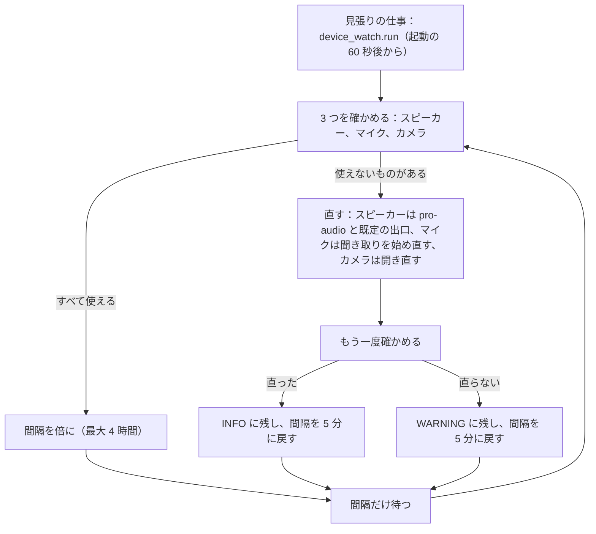

# familiar-ai 設計方針：機器の見張り

> 知-bv（2026-11-14 新設、本人の決定）。パジュは起動のときと、そのあと間をおいて、スピーカー、マイク、カメラが使えるかを
> 確かめ、使えなければ自分で直す。直したことは INFO に残し、直せなかったときだけ WARNING にする。
> **実装した**（2026-11-21）。家での確かめ（本物の直し）は、次に YAMAHA の使い方が `off` になるまで起きない。

## 1. 困っていること

2026-11-14 15:17 にパソコンを起動し直したあと、2 つのことが同時に起きた。どちらも、パジュは気づかず、直さないまま動き続けた。

- **スピーカー**：YAMAHA YVC-300 の使い方の設定（プロファイル）が `off` になり、声が内部オーディオへ出た（その日の 8 回すべて）。
  家の音の仕組み（WirePlumber）は、`pro-audio` を自分からは選ばない。この機体の YVC-300 で選べるのは `off`（番号 0）と
  `pro-audio`（番号 1）の 2 つだけである（2026-11-21 に `pw-dump` を読んで確かめた）。
- **カメラ**：起動の 18 秒後に開けず（`tools/camera.py` の「Failed to open camera source」、11/14 14:58 と 15:18 の 2 回）、
  その回はずっと開き直さなかった。最初に開けないと、取り込みの仕事（`CameraTool._capture_loop`）がそのまま終わるためである。
  途中で読めなくなったときは 2 秒おきに開き直すが、最初の失敗だけは開き直さない。

## 2. 決めたこと

| 番号 | 決めたこと | 出どころ |
|---|---|---|
| (1) | 確かめるのは 3 つ。スピーカーは、既定の出口が YAMAHA か。マイクは、YAMAHA から音が届いているか。カメラは、映像を取り込めているか | 本人の決定（2026-11-14） |
| (2) | 使えなければ自分で直す。スピーカーは `pro-audio` にして既定の出口にする。カメラは開き直す。直したことは INFO、直せなかったときだけ WARNING | 本人の決定（2026-11-14） |
| (3) | 間隔は最初 5 分、使えていれば倍に広げ、最大 4 時間。直したときは 5 分に戻す | 本人の決定（2026-11-14） |
| (4) | マイクが使えなければ、音声の聞き取り（リアルタイムの文字起こし）を始め直して、マイクを開き直す | 仮（本人の確認待ち、2026-11-21） |
| (5) | 直せなかったときも、間隔は 5 分に戻す（直るまで 5 分おきに試し、そのたびに WARNING） | 仮（本人の確認待ち、2026-11-21） |
| (6) | 最初の確かめは起動の 60 秒後。カメラは開くのに 18 秒かかったことがあり、すぐ確かめると開いている途中を「使えない」と取り違える | 仮（本人の確認待ち、2026-11-21） |
| (7) | 「映像を取り込めている」「音が届いている」は、最後の映像と最後の音が 60 秒以内であること | 仮（本人の確認待ち、2026-11-21） |
| (8) | 状態図（`設計方針_パジュの状態`）には入れない。見張りの結果と間隔は、見張りの仕事の中だけで持ち、ほかの誰も読まない。耳、頭、口、体がいま何をしているかではない | 仮（本人の確認待ち、2026-11-21） |
| (9) | 直したあと、新しい映像と音が来るのを 30 秒まで待ってから確かめ直す（カメラは開くのに 18 秒かかったことがある） | 仮（本人の確認待ち、2026-11-21） |

## 3. 仕組み

見張りは、GUI の起動の終わり（`gui.py` の `_initialize_agent`、音声の聞き取りを始めたあと）に立てる 1 つの裏の仕事である。
試験は本物の機器を触らない（直す命令は差し替えられる口から呼ぶ）。全体テストもこの機体で回るので、試験が本物の YAMAHA の
設定を変えないためである。

### 3.1 スピーカー

- **確かめ方**：既定の出口（`wpctl inspect @DEFAULT_AUDIO_SINK@`）の説明（`node.description`）に、出口の機器の名前
  （`AgentConfig.audio_device`・2026-11-23 まで `.env` の `AUDIO_OUTPUT_DEVICE`／`AUDIO_INPUT_DEVICE`）が入っているか。名前の設定が無ければ確かめない。
- **直し方**：
  1. `pw-dump` から、説明に機器の名前が入っている機器を引く。機器の番号と `pro-audio` の番号は、毎回ここで引く（起動ごとに変わる）。
  2. いまの使い方が `pro-audio` でなければ、`wpctl set-profile <機器の番号> <pro-audio の番号>`。
  3. 出口（`Audio/Sink`）が現れるのを、1 秒おきに 5 回まで待つ（使い方を変えると、出口はあとから現れる）。
  4. `wpctl set-default <出口の番号>`。
- 声の出し先（`pw-play --target`）は、名指しで選べればそのまま使う。見張りが直すのは、名指しできなかったときに流れる既定の
  出口と、名指しの先になる出口が無い状態である。

### 3.2 マイク

- **確かめ方**：マイクの取り込み（`MicCapture`）が最後に音を受けた時刻が 60 秒以内で、開いた機器の名前に
  機器の名前（`AgentConfig.audio_device`）が入っているか。マイクは鳴っていなくても無音の音を受け続けるので、時刻が古いのは取り込みが
  止まったときである。ただし YAMAHA が見つからず既定の入力（内部マイク）へ落ちたときも無音の音は届くので、機器の
  名前も見る。聞き取りを止めているとき（GUI で切った、聞き取りの設定が無い）は確かめない。始めるのに失敗したときと、
  始め直しの途中で落ちたときは、止めたのとは分けて、確かめ続ける。
- **直し方**：音声の聞き取りを始め直す（`RealtimeSttController.restart`。手で始め直すボタンと同じ道）。

### 3.3 カメラ

- **確かめ方**：取り込みの仕事が最後に映像を受けた時刻が、60 秒以内か。カメラの設定が無ければ確かめない。
- **直し方**：取り込みの仕事が終わっていれば、立て直す（`CameraTool.reopen`）。仕事が生きているのに映像が古いときは、
  仕事が 2 秒おきに開き直している最中なので、二重に立てない（2 つの仕事が同じカメラを取り合う）。そのときは待たずに確かめ直し、
  古いままなら直せなかったとする。古さは初めて仕事を立てた時刻から数え、立て直しで 0 に戻さない（戻すと、開けないままでも
  直ったと見誤る）。閉じたあとは立て直さない。

### 3.4 置き場

| 置き場 | 中身 |
|---|---|
| `core/device_watch.py` | 次の間隔を決める純関数（`next_interval`）と、確かめの結果の型 |
| `io/device_watch.py` | 3 つの確かめと直し方、見張りの仕事（`run`）。命令はすべて差し替えられる口から呼ぶ |
| `config.py` の `DeviceWatchConfig` | 最初の確かめまでの秒、最初の間隔、最大の間隔、古いとみなす秒、直したあと待つ秒 |
| `tools/camera.py` | 最後に映像を受けた時刻と、`reopen` |
| `tools/mic.py` | 開いた機器の名前 |
| `realtime_stt_session.py` | 初めて始めた時刻、最後に音を受けた時刻、回したいか、その読み口（`mic_audio_age`） |
| `gui.py` の `_run_device_watch` | 見張りを立て、見張るマイクの聞き取り（`_watched_stt`）を毎回引く |

## 4. 確かめていないこと

- 本物の直しは、次にパソコンを起動し直して YAMAHA が `off` になるまで、実機では起きない。読み取りだけの確かめは、この機体で回す。
- 使い方の「モノ」が消えた理由は、まだ分かっていない。
